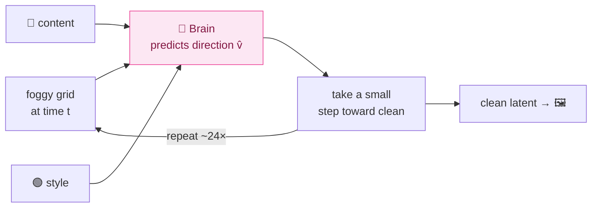
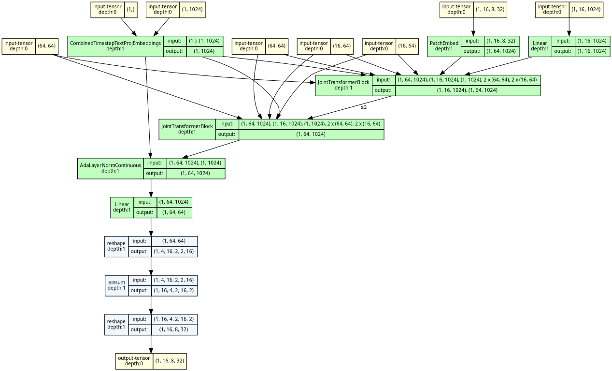
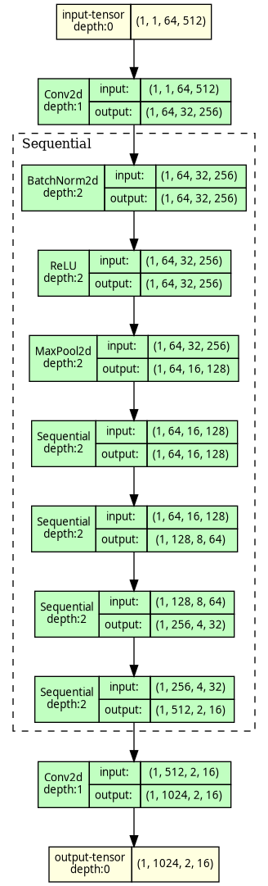
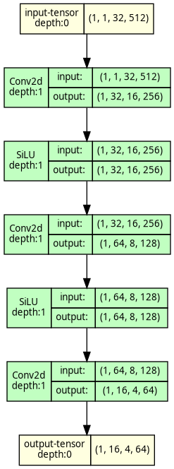

# The Illustrated Diffu

> A gentle, visual walkthrough of how Diffu works — black box first, then we crack it open one
> piece at a time. No prior diffusion knowledge assumed. The dense reference (exact shapes, params,
> measured numbers, traced graphs) lives in the **[Appendix](#appendix--the-reference-sheet)** at the
> bottom; this top half is for *understanding*.
>
> The scoreboard for everything below is one number: **HTR Character Error Rate (CER)** — how often a
> handwriting-reading AI misreads the lines Diffu generates. Pretty pictures don't count; legibility does.

---

## 1. Start with the black box

You hand Diffu two things and it hands you one thing back:

```
   "Göteborg"   ┌──────────────┐
   (some text)  │              │      an image of that text,
        ──────▶ │    DIFFU     │ ────▶ written in that handwriting,
   ✍ a sample   │              │       with correct å ä ö
   of a hand    └──────────────┘
   (style ref)
```

That's the whole promise: **give it a *text* and a *handwriting sample*; it draws that text in that hand.**

Why would anyone want this? Because AI that *reads* old handwriting learns from examples — an image of a
line plus what it says. Real 1800s Swedish handwriting *with* a transcription is scarce and expensive. If
Diffu can invent thousands of realistic lines whose text we already know, the reader-AI gets far more to
practice on.

---

## 2. The one analogy: it learns to *un-blur*

Here's the single idea the whole model rests on. We never teach Diffu to "write." We teach it to **remove
fog**.

Take a real handwritten line. Slowly smear it into pure television-static noise. Now drill the *reverse*:

```
   clean line  ──add a little fog──▶  ──more──▶  ──more──▶   pure static
   Göteborg                                                     ▓▓▓▓▓▓▓

        ◀──────────────  the model learns THIS direction  ──────────────
                    "given a foggy image, guess the way back to clear"
```

Do that millions of times on real lines and the model learns the general *motion* of un-fogging
handwriting. Then to **generate** something new: hand it a fresh sheet of pure static and let it un-fog —
but whisper two hints the whole way down: *what it should say* and *whose hand to use*.

That "un-blur along a straight line" is the modern recipe called **rectified flow**. Everything else in
this document is just *how we whisper the two hints* and *what shape the fog lives in*.

---

## 3. Crack the box open: four parts

Zoom in once. Diffu is four cooperating pieces:

```mermaid
flowchart LR
    T["📝 text<br/>'Göteborg'"] --> C["Content reader<br/><i>what to write</i>"]
    S["✍ style sample"] --> ST["Style reader<br/><i>whose hand</i>"]
    N["🌫 pure noise"] --> B["The Brain<br/>(un-blurrer)"]
    C --> B
    ST --> B
    B --> V["Decoder<br/><i>idea → pixels</i>"]
    V --> O["🖼 finished line"]

    classDef content fill:#dbeafe,stroke:#3b82f6,color:#1e3a8a
    classDef style fill:#dcfce7,stroke:#22c55e,color:#14532d
    classDef brain fill:#fce7f3,stroke:#ec4899,color:#831843
    classDef vae fill:#f3f4f6,stroke:#9ca3af,color:#374151
    class C content
    class ST style
    class B brain
    class V,N vae
```

- 🔵 **Content reader** — turns the text into a row of "letter pictures" so the Brain knows *which letter
  goes roughly where*.
- 🟢 **Style reader** — looks at the handwriting sample and distills *the hand* (slant, stroke weight) —
  deliberately **not** the actual words in it.
- 🔴 **The Brain** — the big network that does the un-blurring, listening to both readers at every step.
- ⚪ **The Decoder** — turns the Brain's compressed "idea" back into real pixels.

We'll keep these four colors consistent for the rest of the doc. Let's meet them one at a time — but
first, the space they all work in.

---

## 4. Diffu doesn't paint pixels — it paints in "idea space"

Painting a 64×1024 image pixel-by-pixel is wasteful. So before anything else, we **compress**.

A frozen autoencoder (the **VAE**) squeezes a handwriting line down to a tiny grid of numbers — the
*latent*, or "idea space" — and can expand it back to pixels later:

```
   PIXELS                                   LATENT  ("idea space")
   ┌───────────────────────────────┐        ┌──────────────┐
   │  3 channels × 64 × 1024        │  ───▶  │ 16 × 8 × 128  │     ~64× smaller
   │  (a handwriting line)          │  VAE   └──────────────┘
   └───────────────────────────────┘  encode        │
                                                     │ VAE decode (at the very end)
                                                     ▼
                                              back to 3 × 64 × 1024 pixels
```

The Brain only ever works on that little `16 × 8 × 128` grid. Cheaper, and easier to learn.

**One choice here mattered a lot:** we use a **16-channel** latent (most older models use 4). With only 4
channels, the fine strokes that separate `a` from `ä` and `å` get *smeared* — and once the dots on `ä` are
gone, nothing downstream can bring them back. 16 channels keep the diacritics alive. (We even refuse to
start training unless a round-trip "encode → decode → read it" passes a legibility check — the
`recon_cer_gate`.)

> 🟢 **Why "frozen"?** The VAE was pre-trained by someone else and we mostly leave it alone (we only
> lightly fine-tune the *decoder* to render Swedish ink nicely). It defines the idea-space; the Brain
> learns to navigate it.

---

## 5. The un-blurring loop, step by step

Now the heart of it. To generate a line, we start from a grid of pure noise and un-fog it over a handful
of steps:

```
  step:   24 ─────────────────────────────────────────────────▶ 0
  "time": t=1.0      t=0.75      t=0.5       t=0.25      t=0.0
          noise  ──▶ less fog ─▶ strokes ──▶ letters ──▶ clean
          ▓▓▓▓▓▓     ▒▒░▒▓░       ░ ʃ ʅ ░     Göteʙσ      Göteborg
            └───────────┬──────────────────────────┘
              at EVERY step the Brain looks at the
              current foggy grid + the two hints,
              and predicts "which way is clearer?"
```

At each step the Brain answers one question: **"from this foggy grid, which direction points toward
clean?"** We nudge the grid a little in that direction, and repeat. After ~24 nudges, the noise has
become a clean latent, and the Decoder turns it into pixels.



> 📐 **The one bit of math, kept small.** "Foggy at time *t*" is literally a blend:
> `x_t = (1−t)·clean + t·noise`. At `t=1` it's all noise; at `t=0` all clean. The "direction toward
> clear" the Brain predicts is just `clean − noise`'s opposite, written `v = noise − clean` (called the
> *velocity*). That's it — a straight line from noise to clean, and the Brain learns its slope.

A nice consequence: **the number of steps is purely an inference choice.** Training only ever shows the
Brain *one* random fog level at a time. Want smoother strokes? Use more steps. No retraining. (In practice
~24 is the sweet spot; see the appendix sweep.)

---

## 6. Hint #1 — telling it *what* to write (the 🔵 content reader)

How do you tell a vision model "write the letters G-ö-t-e-b-o-r-g, in this order"? You don't hand it the
string — you hand it **pictures of the letters**, lined up.

**Step 1 — stencil.** Each character is stamped from a font (GNU-Unifont, which covers *every* Unicode
letter, so even a rare historical glyph has a correct picture by construction) into a little bitmap:

```
   text:  G   ö   t   e   b   o   r   g
          ┌─┐┌─┐┌─┐┌─┐┌─┐┌─┐┌─┐┌─┐
          │G││ö││t││e││b││o││r││g│   ← a strip of glyph stencils
          └─┘└─┘└─┘└─┘└─┘└─┘└─┘└─┘
```

**Step 2 — a small CNN reads the strip** and turns it into a row of feature vectors — crucially **keeping
the left-to-right order** (it throws away the usual "flatten to one vector" step, so *position survives*).

**Step 3 — line it up with the image columns.** The strip is resampled so there's **one content vector per
column of the latent grid**:

```
   latent columns:   1    2    3    4    5   ...  128
                     │    │    │    │    │         │
   content tokens:  [G]  [ö]  [t]  [e]  [b]  ...  [ ]   ← token j ⟷ column j
```

So the Brain doesn't just know *what* letters to write — it knows roughly *where each one sits*. That
column-to-column correspondence is the backbone of legibility, and we lock it in place with a positional
trick covered in §8.

> ⚙️ Two flavors exist in the code: the default renders **one stencil per character**; an experimental
> mode renders the **whole line as one image**. Both end as column-aligned content tokens — the picture
> above is true either way. (Exact flags: appendix.)

---

## 7. Hint #2 — telling it *whose* hand (the 🟢 style reader)

The style sample is a crop of someone's real handwriting. We want to extract *the hand* — slant, stroke
thickness, rhythm — **without** copying the actual letters in that crop.

```
   ✍ style crop ──▶ DINOv3 (a strong, frozen vision encoder) ──▶ ──pool──▶  one style vector
                                                                              [ • • • ... • ]
                                                                              "the hand", as numbers
```

That single **style vector** is fed to the Brain as a global "tone knob" (it tunes every layer at once,
the way a thermostat sets the temperature of a whole house — see AdaLN in §8).

**Why squeeze it to a single vector?** Here's a real bug we hit and fixed. If you feed the Brain the
*detailed, spatial* style features instead of one pooled vector, those features secretly carry the
**shapes of the letters** in the style crop. The Brain then just *copies those letters* and ignores your
text:

```
   detailed style features  →  Brain copies the reference's WORDS  ❌  (text ignored)
   one pooled vector        →  Brain keeps only the HAND, writes YOUR text  ✅
```

Pooling to one vector strips the "which letters" information and leaves only "what the hand looks like" —
forcing the content to come from the 🔵 content reader, where it belongs.

> ⚙️ The leak-free pooled-only mode is the recommended setting; a richer-but-leaky "style tokens in
> context" mode also exists behind a flag. (Appendix.)

---

## 8. The Brain — how text and image actually mix (🔴 MMDiT)

The Brain is a **transformer** (specifically diffusers' SD3 MMDiT — we use the battle-tested library
rather than hand-rolling it). Two things make it tick.

**(a) Everything becomes tokens, and they all talk at once.** The foggy latent is chopped into patches →
image tokens. The content reader gave us content tokens. We line them up in one sequence and run **one
shared attention** so every image patch can look at every other patch *and* every letter, in the same
computation:

```
   ┌─ image tokens (the foggy grid, in patches) ─┐ ┌─ content tokens (the letters) ─┐
   [img][img][img][img] ............ [img][img]     [G][ö][t][e][b][o][r][g]
    └──────────────────────  ONE attention over the whole row  ──────────────────┘
        every patch attends to every letter, and vice-versa, in every layer
```

This is the "MM" (multi-modal) in MMDiT: text and pixels co-shape each other *directly*, layer after
layer — not through a bolted-on side channel.

**(b) Position via rotation, not a fixed table (2D-RoPE).** A transformer needs to know *where* each token
sits. Older models used a fixed position table — but a fixed table has a **maximum width**, and our lines
vary from one word to a full sentence. So we instead **rotate** each token's vector by an angle that
encodes its row and column. Rotation is *relative*, so any width works — no cap, no overflow. And we give
content token *j* the *same* column-rotation as image column *j*, which is what nails down the
"letter-here, ink-there" alignment from §6 for free.

```
   fixed position table:   [0][1][2]...[max] ✗ runs out → wide lines overflow
   rotary (RoPE):          rotate by angle(row,col) ✓ any width, content & image share columns
```

**(c) The style vector as a global knob (AdaLN).** Remember the single 🟢 style vector? It (plus the
current fog-level *t*) sets a scale-and-shift on every layer's normalization — a *global* modulation of
the whole network, separate from the token conversation. That's how "whose hand" colors everything at once.

> The Brain is ~900M parameters and trained **from scratch** — it starts knowing nothing and learns the
> whole un-blurring skill. (Exact dims in the appendix.)

---

## 9. How it learns (training, in one picture)

Training is just the un-blurring drill from §2, made concrete:

```mermaid
flowchart TD
    A["real line 🖼"] -->|VAE encode ❄️| X0["clean latent x₀"]
    T["pick a random fog level t"] --> XT
    EPS["fresh noise ε"] --> XT["fog it: x_t = (1−t)·x₀ + t·ε"]
    X0 --> XT
    TXT["🔵 text → content tokens"] --> BR["🔴 Brain predicts direction v̂"]
    STY["🟢 style → style vector"] --> BR
    XT --> BR
    BR --> LOSS["how wrong was the direction?<br/>L = ‖ v̂ − (ε − x₀) ‖²"]
    LOSS -->|"nudge the Brain's weights"| BR

    classDef content fill:#dbeafe,stroke:#3b82f6,color:#1e3a8a
    classDef style fill:#dcfce7,stroke:#22c55e,color:#14532d
    classDef brain fill:#fce7f3,stroke:#ec4899,color:#831843
    class TXT content
    class STY style
    class BR brain
```

For each real line: encode it, pick a random fog level, fog it, ask the Brain which way is clear, and
penalize it for pointing wrong. Millions of times. That single loss — *predict the un-blur direction* — is
the entire training signal. (An optional tweak up-weights the rare "ink" pixels so the ~90% white paper
doesn't dominate; off by default.)

---

## 10. A head-start for the Brain (REPA)

A from-scratch Brain has to discover basic visual structure on its own, which is slow. **REPA** gives it a
shortcut: partway through the network, we nudge the Brain's internal picture to *resemble* how a frozen,
already-smart vision model (DINO — the same family as the 🟢 style reader) sees the **target** image.

```
   Brain's middle layer  ──project──▶  [ its view ]
                                            ≈  ?     ← "make these point the same way"
   frozen DINO of target ───────────▶  [ DINO view ]
```

It's like giving an art student reference anatomy sketches instead of making them re-derive anatomy. The
result: faster convergence and finer detail (helpful for diacritics). It runs **only during training** and
costs nothing at generation time.

> One honest caveat we've learned (and act on for the big run): REPA helps *early* but if you leave it on
> the whole time it starts *erasing* fine detail. Best practice is to switch it off after the first
> ~30–40% of training. (Details + the relevant paper: appendix.)

---

## 11. Generating, and the one big lever (CFG)

To make a new line: start from noise, run the un-blur loop (§5) ~24 times, decode. But there's a trick
that, more than anything else, decides whether the result is *readable*.

**Classifier-free guidance (CFG).** At each step, run the Brain **twice** — once with the text, once with
the text *removed* (style kept) — and then **exaggerate the difference**:

```
   v_with_text   ─┐
                  ├──▶  v = v_noText + s·( v_with_text − v_noText )
   v_no_text     ─┘                          ▲
                                    "the part that depends on THIS text" — amplified (shipped default s = 5)
```

`v_with_text − v_no_text` is precisely the direction that depends on the requested letters. Multiply it by
`s` (the shipped default is 5) and you push the model to follow the text harder than it naturally would. In our measurements this
is the single biggest legibility win — it roughly **3×'d** the readability of the base model, far more than
anything else we tried. (It costs 2× compute per step, since it's two forward passes.)

```
   no guidance (s=1):   barely-readable scribble       CER ~0.51
   guidance  (s≈3):     clearly the right letters       CER ~0.16
```

(Those are 64 px-era sweep numbers; the released 128 px model ships `cfg_scale=5` and reads at ~2–5 %.)

This only works because training occasionally *dropped* the text hint, teaching the Brain a "no-text" mode
to contrast against.

---

## 12. What's still hard (the honest gaps)

No spin — these are the open problems, and they're what the scale-up targets:

- **It can't stop on its own.** Trained on tight crops, the model learned "fill the canvas," so on a
  too-wide canvas it *repeats letters to fill the space*. Workaround: we size the canvas to the text
  (~15 px/char). Real fix: make "how full is the line" a proper input.
- **Style is generic.** Because we pool the style to avoid copying letters, we also lose some fidelity to
  the *specific* hand. A content-decoupled style encoder is the open research item.
- **Legibility ceiling.** Guided CER was ~0.16 in the 64 px era; the released 128 px model
  (`Gabriel/diffu_sd35_128`) reads at ~2–5 % — past the ~0.086 published bar. The remaining gap to real
  lines (~1.6 %) is stroke quality, still a scale-up bet, not a one-line fix.
- **The base must actually follow the text first.** Everything above assumes the Brain has learned to obey
  the content hint. When it hasn't (a failure mode called *marginal collapse*), no amount of guidance or
  fine-tuning helps — fixing the base comes first.

---

### 30-second version
> Compress a handwriting line to a small 16-channel "idea grid" (a frozen VAE, chosen to keep å ä ö).
> Train a 900M transformer from scratch to **un-blur** noise back into a clean grid (rectified flow:
> predict the direction `noise − clean`), while whispering two hints — a **stencil of the text**
> (column-aligned so each letter knows its place) and a **pooled style vector** (so it copies the *hand*,
> not the *words*). A **REPA** loss gives the Brain a representation head-start from a frozen vision model.
> Generate by un-blurring noise ~24 steps with **guidance** that leans on the text, then decode to pixels.
> Open problems: stopping at the right length, style fidelity, and the legibility ceiling.

---
---

# Appendix — the reference sheet

*Everything below is the dense, exact reference: precise shapes, parameter counts, measured numbers,
traced graphs, and config flags. The walkthrough above is for intuition; this half is for implementing
and double-checking.*

## A. The shape journey (one line through the whole system)

(Shapes shown are 64 px-era — the released model is 128 px, so double the H dims: image `[B,3,128,W]`,
latent `[B,16,16,W/8]`, `h_t=8`.)

```
image  [B, 3, 64, W]                         ← a 64-px-tall handwriting line, pixels in [-1,1]
  │  VAE.encode (frozen encoder, f8)
latent x0  [B, 16, 8, W/8]                    ← 16 channels, 8 rows, W/8 cols   (the "idea space")
  │  PatchEmbed conv, patch=2, flatten row-major
image tokens  [B, h_t·w_t, 1024]             ← h_t=4, w_t=W/16  → up to 256 tokens (variable!)
  +  content tokens [B, w_t, 1024]   (the text, column-aligned)
  +  style tokens   [B, 64, 1024]    (optional; see style_in_context)        → joint-attention "context"
  +  pooled vector  [B, 1024]         (the style, via AdaLN)       + timestep
  │  SD3 MMDiT × 24 blocks  (predict velocity)
v̂  [B, 16, 8, W/8]                            ← the un-blur direction
  │  (training) loss vs ε−x0   |   (inference) scheduler step ×24 → x0 → VAE.decode → [B,3,64,W]
```

## B. Component reference

**VAE — Qwen-Image 16-ch f8.** `Qwen/Qwen-Image` subfolder `vae` (~80–100M). `image [B,3,64,W] →
latent [B,16,8,W/8]`; widest at `max_line_width=1024` is `[B,16,8,128]`. Wan/video-derived (5-D), so
`vae.py` wraps each still line as a 1-frame video and squeezes the time dim back off. `encode` is
`@torch.no_grad`, **samples** the posterior, normalizes per-channel (constants from the VAE config, never
hardcoded). **Encoder frozen; decoder fine-tuned** (`finetune_decoder_only`). `recon_cer_gate` round-trips
real lines through encode→decode→HTR and refuses to start if the latent alone drops legibility.

**Content encoder.** Unifont stencil at `glyph_size=32` (not native 16, so diacritic rings survive the
CNN). Default = **per-character tokens** (`glyph_line=False`); optional whole-line mode (`glyph_line=True`)
renders the line as one image. CNN = ResNet-18 trunk (ImageNet-pretrained stem, 1-ch conv1), **avgpool+fc
dropped** so the spatial map survives; 1×1 conv `512→1024`; `F.interpolate(size=(1, w_tokens))` pools
height→1 and resamples width→`w_tokens`; `flatten(2).transpose(1,2)` → `[B, w_tokens, 1024]`. Token *j* ⟷
latent column *j*.

**Style encoder.** DINOv3 ViT-L/16 frozen (`facebook/dinov3-vitl16-pretrain-lvd1689m`). Crop `[B,3,224,224] → last_hidden_state [B,196,1024]`. Perceiver
resampler (64 learned latents query the patches, 2 blocks/8 heads) → `[B,64,1024]`. AttentionPool (1
learned query) → `[B,1024]` pooled AdaLN vector. `fill_ratio` scalar (text-width ÷ canvas-width) →
`MLP(1→1024→1024)` → added into the pooled vector. **Flags:** `style_in_context` (config default `True` =
spatial style tokens enter joint attention; recommended leak-free setting is pooled-only). `style_tokens=64`.

**Backbone — SD3 MMDiT.** diffusers `SD3Transformer2DModel`. `dim=1024 · num_layers=24 · heads=16 ·
head_dim=64 · patch=2 · context_dim=1024` → **~900M params (see PERF_AUDIT §0f), fully trainable** (only VAE-encoder, DINO, HTR
are frozen). PatchEmbed conv patch=2 → `[B, h_t·w_t, 1024]` row-major (h=8→h_t=4, w_t=W/16 → up to 256
image tokens). Joint attention: project image and text (content+style) Q/K/V, **2D-RoPE on image Q/K**,
concatenate `[image, text]`, one `scaled_dot_product_attention`, split back. **SD3.5 upgrade:**
`qk_norm="rms_norm"` (RMSNorm on Q/K) on by default. `dual_attention_layers=()` (the heavier
SD3.5-medium image-only attn2) wired/tested but off. `RoPEJointAttnProcessor` rotates both joint attn and
dual attn2.

**2D-RoPE.** `build_2d_rope` → `(cos,sin)` with first 32 channels = row index, last 32 = column index
(head_dim 64, θ=10000). Replaces SD3's absolute sincos table (which is capped at `pos_embed_max_size` and
is the wide-line overflow root cause). Shared-column trick: content token *j* rotated with the same column
frequency as image column *j*.

## C. Training objective (exact)

- Interpolant (t=0 data, t=1 noise): `x_t = (1−t)·x0 + t·ε`; target velocity `v = ε − x0`.
- Timesteps: `t = sigmoid(N(0,1))` (logit-normal), fed to the backbone as `t·1000` (SD3 scale).
- Loss: `L_flow = mean((v̂ − v)²)`; recover `x0 = x_t − t·v̂`.
- Why velocity: it's the constant slope of the straight noise↔clean line → trains stably.
- Ink-focal (off by default): up-weight ink cells ×3 (`mask = gray < 0.3`, area-pooled to the latent).

## D. REPA (exact tensor flow)

1. **Tap:** forward hook on `transformer_blocks[8]`; SD3 block returns `(text_hidden, image_hidden)` —
   grab `output[1]` = image hidden `[B, N, 1024]` (N = h_t·w_t). Guard raises if these don't require grad
   (reentrant-checkpoint detach trap) so REPA trains the backbone.
2. **Project:** `repa_proj` (currently a 3-layer SiLU MLP) `1024 → D_dino(=1024)` → `[B, N, 1024]`.
3. **DINO target (frozen, no_grad):** target `[-1,1]→[0,1]→224²→ImageNet-norm→`DINO→ keep 196 patch
   tokens → `[B,1024,14,14]` → bilinear-resample to `[B,1024,h_t,w_t]` → flatten row-major → `[B,N,1024]`.
   Row-major both sides ⇒ DiT token *i* ⟷ DINO patch *i*.
4. **Loss:** per-token cosine `mean(1 − cos(L2(proj), L2(target)))` × `repa_weight(=0.5)`. Not pooled.
   Training-only (`.training`). `repa_layer=8`, `repa_stop_frac=0.4` (HASTE early-stop).
- Total loss `L = L_flow + 0.5·L_repa`; only `L_flow` is logged (val-comparable).

## E. Inference + CFG (exact)

1. Start from noise `[B,16,8,W/8]` at t=1; canvas width = `len × ~15 px/char`.
2. ~24 steps (t:1→0) via `FlowMatchEulerDiscreteScheduler`: predict `v̂`, step toward clean.
3. CFG: second pass with **content tokens zeroed** (style/pooled kept); `v = v_uncond + s·(v_cond −
   v_uncond)`, shipped default `s=5`. Enabled by training with `cond_dropout`/`text_dropout`.
4. Decode → ink-crop the tail.

**Measured — sampling steps** (width fixed, base model):

| steps | 8 | 16 | 24 | **40** | 60 |
|---|---|---|---|---|---|
| mean CER | 0.089 | 0.089 | 0.073 | **0.052** | 0.079 |
| time/line | 0.4s | 0.7s | 1.0s | 1.7s | 2.5s |

→ roughly flat; default ~24, 40 for cleanest strokes, never 60. Steps polish render quality, not legibility.

**Measured — CFG:** unguided gen_CER ~0.51 → ~0.16 at s≈3 (~3×; 64 px-era sweep). The single biggest
legibility lever. The released 128 px model ships `cfg_scale=5` and reads at ~2–5 %.

## F. Auto-width & length control (the biggest quirk)

The model has no internal length control (trained on tight crops → "fill the canvas"). Auto-width:
`width = round16(len(text) × 26.4 × _WIDTH_BIAS)`, capped at 1024, then `ink_crop` trims the blank tail.
Corpus density ≈ **15 px/char** (median 15, mean 18 over 2000 real lines). CER vs px/char is monotonic:

| px/char | 30 (old default) | 24 | 18 | **15 (= corpus)** |
|---|---|---|---|---|
| mean CER | **0.41** | 0.18 | 0.09 | **0.037** |

→ Fix was a one-liner `_WIDTH_BIAS = 0.55` (~15 px/char), ~11× CER drop vs 30 px/char. White-pad training
alone did not fix overflow (tested 60k steps); proper fix is `fill_ratio` as its own conditioning channel +
variable-width training.

## G. Best-practice audit (vs HASTE 2505.16792 — REPA early-stop)

**Right:** cosine (not MSE) alignment · weight 0.5 · layer 8 (correct for 24-layer XL/L) · frozen DINOv3-L
reused for style · per-token spatial correspondence · clean velocity + logit-normal.

**Gaps (scheduling/inference-side, ranked):** (1) 🔴 terminate REPA early ~30–40% (HASTE); (2) timestep
shift `s≈√(C·H·W/4096)` on training t + sampler (currently shift=1.0); (3) interval CFG `t∈[0.3,0.7]` at
lower scale ~1.5–2; (4) 3-layer SiLU MLP REPA projector (done); (5) EMA warmup; (6) (research) DINO-latent
AE (HAE 2601.22904 / RAE / REPA-E) — future, not next run. HAE is the *Hyperspherical Autoencoder* (DINO-
latent + Riemannian flow), not a timestep-shift paper; 2509.23624 is *DiffInk* (online-ink DDPM).

## H. Traced model graphs (generated from the live code)

Regenerate with `python scripts/visualize_model.py` (CPU-only, needs graphviz `dot`). Interactive
companion: [`architecture.html`](architecture.html).

| Artifact | What it shows |
|---|---|
| `mmdit_graph.png` | SD3 MMDiT spine with shapes: PatchEmbed `[1,16,8,32]→[1,64,1024]` · context Linear · timestep+pooled→AdaLN · JointTransformerBlock ×N (image + text streams + RoPE) · AdaLayerNormContinuous · unpatchify `→[1,16,8,32]`. |
| `content_cnn_graph.png` | Glyph-line ResNet-18 trunk: `[1,1,64,512]→…→[1,1024,2,16]` down-sampling funnel. |
| `glyph_latent_graph.png` | Glyph-latent conv block: `[1,1,32,512]→…→[1,16,4,64]` (3× Conv2d-stride2 → SiLU). |
| [`model_graph_mmdit.html`](model_graph_mmdit.html) | Interactive trace (zoom/click any node). |







## I. Inference stack & current runs (updated 2026-07-13)

**Released model:** `exp_sd35_128/step_120000` (**128 px**, glyph-line content, pooled-only style, SD3.5
qk-norm, CFG-null fix) — published as
[`Gabriel/diffu_sd35_128`](https://huggingface.co/Gabriel/diffu_sd35_128) (2026-07-05). Generated lines
read back at ~2–5 % CER through the Riksarkivet HTR recogniser at `cfg_scale=5`. Supersedes the earlier
64 px [`Gabriel/test_sd35`](https://huggingface.co/Gabriel/test_sd35).

**The run behind it:** `exp_sd35_128` — same architecture at **128 px** (2× vertical detail; the f8 VAE
ceiling was 8 latent rows at 64 px) **plus the CFG-null fix**: trained with BOTH `--cond-dropout 0.1`
(full null) and `--text-dropout 0.1` (text-null, style kept). Earlier runs trained only the full null
while inference does text-CFG — a train/inference null mismatch this run removes. 2-GPU DDP, eff-batch
96. **Arc ended 2026-07-05:** killed at step 216k — converged ~100k; `step_120000` is the release.

**The one-call inference API** (`src/diffu/pipeline.py`):

```python
from diffu.pipeline import DiffuPipeline
pipe = DiffuPipeline.from_pretrained("Gabriel/diffu_sd35_128")   # or a local dir
img = pipe("Göteborgs poliskammare", style="line_crop.png", cfg_scale=5.0)
```

Inference facts (all measured, `scripts/bench_quant.py`):
- **bf16 runs end-to-end** (glyph renders, noise latent, scheduler boundary, and PIL conversion all cast
  correctly as of 2026-07-02); fp32 inference enables **TF32** matmuls at the entry points.
- **Regional compile is `dynamic=True`** — one compile covers variable line widths;
  `compile_backbone=True` pays a one-time cold start and wins for many-line/served workloads
  (~0.37 s/line compiled vs ~1 s eager).
- **Quantization is a measured LOSS on this model** (Blackwell, torchao 0.17: int8 slower, fp8dq ~2×
  slower; CER unaffected) — ship compiled bf16; `diffu.quantize` stays as an opt-in for other hardware.
  Details: `docs/PERF_AUDIT.md` §0f.
- Loaders (CLI, pipeline, studio, page renderer) all run `assert_conditioner_loaded` — a checkpoint whose
  text-conditioner doesn't match the built architecture raises instead of generating confident gibberish.
