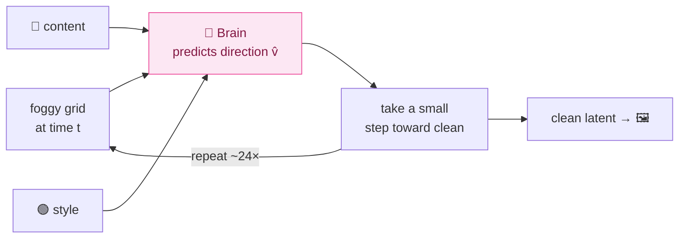

# The Illustrated Diffu

> A gentle, visual walkthrough of how Diffu works — black box first, then we crack it open one
> piece at a time. No prior diffusion knowledge assumed. The dense reference (exact shapes, params,
> measured numbers, traced graphs) lives in the **[Appendix](#appendix--the-reference-sheet)** at the
> bottom; this top half is for *understanding*.
>
> The scoreboard for everything below is one number: **HTR Character Error Rate (CER)** — how often a
> handwriting-reading AI misreads the lines Diffu generates. Pretty pictures don't count; legibility does.

---

## 1. Start with the black box

You hand Diffu two things and it hands you one thing back:

```
   "Göteborg"   ┌──────────────┐
   (some text)  │              │      an image of that text,
        ──────▶ │    DIFFU     │ ────▶ written in that handwriting,
   ✍ a sample   │              │       with correct å ä ö
   of a hand    └──────────────┘
   (style ref)
```

That's the whole promise: **give it a *text* and a *handwriting sample*; it draws that text in that hand.**

Why would anyone want this? Because AI that *reads* old handwriting learns from examples — an image of a
line plus what it says. Real 1800s Swedish handwriting *with* a transcription is scarce and expensive. If
Diffu can invent thousands of realistic lines whose text we already know, the reader-AI gets far more to
practice on.

---

## 2. The one analogy: it learns to *un-blur*

Here's the single idea the whole model rests on. We never teach Diffu to "write." We teach it to **remove
fog**.

Take a real handwritten line. Slowly smear it into pure television-static noise. Now drill the *reverse*:

```
   clean line  ──add a little fog──▶  ──more──▶  ──more──▶   pure static
   Göteborg                                                     ▓▓▓▓▓▓▓

        ◀──────────────  the model learns THIS direction  ──────────────
                    "given a foggy image, guess the way back to clear"
```

Do that millions of times on real lines and the model learns the general *motion* of un-fogging
handwriting. Then to **generate** something new: hand it a fresh sheet of pure static and let it un-fog —
but whisper two hints the whole way down: *what it should say* and *whose hand to use*.

That "un-blur along a straight line" is the modern recipe called **rectified flow**. Everything else in
this document is just *how we whisper the two hints* and *what shape the fog lives in*.

---

## 3. Crack the box open: four parts

Zoom in once. Diffu is four cooperating pieces:

```mermaid
flowchart LR
    T["📝 text<br/>'Göteborg'"] --> C["Content reader<br/><i>what to write</i>"]
    S["✍ style sample"] --> ST["Style reader<br/><i>whose hand</i>"]
    N["🌫 pure noise"] --> B["The Brain<br/>(un-blurrer)"]
    C --> B
    ST --> B
    B --> V["Decoder<br/><i>idea → pixels</i>"]
    V --> O["🖼 finished line"]

    classDef content fill:#dbeafe,stroke:#3b82f6,color:#1e3a8a
    classDef style fill:#dcfce7,stroke:#22c55e,color:#14532d
    classDef brain fill:#fce7f3,stroke:#ec4899,color:#831843
    classDef vae fill:#f3f4f6,stroke:#9ca3af,color:#374151
    class C content
    class ST style
    class B brain
    class V,N vae
```

- 🔵 **Content reader** — turns the text into a row of "letter pictures" so the Brain knows *which letter
  goes roughly where*.
- 🟢 **Style reader** — looks at the handwriting sample and distills *the hand* (slant, stroke weight) —
  deliberately **not** the actual words in it.
- 🔴 **The Brain** — the big network that does the un-blurring, listening to both readers at every step.
- ⚪ **The Decoder** — turns the Brain's compressed "idea" back into real pixels.

We'll keep these four colors consistent for the rest of the doc. Let's meet them one at a time — but
first, the space they all work in.

---

## 4. Diffu doesn't paint pixels — it paints in "idea space"

Painting a 128×1024 image pixel-by-pixel is wasteful. So before anything else, we **compress**.

A frozen autoencoder (the **VAE**) squeezes a handwriting line down to a tiny grid of numbers — the
*latent*, or "idea space" — and can expand it back to pixels later:

```
   PIXELS                                    LATENT  ("idea space")
   ┌────────────────────────────────┐       ┌───────────────┐
   │  3 channels × 128 × 1024       │  ───▶ │ 16 × 16 × 128 │   8× smaller in height and in width
   │  (a handwriting line)          │  VAE  └───────────────┘
   └────────────────────────────────┘ encode        │
                                                    │ VAE decode (at the very end)
                                                    ▼
                                            back to 3 × 128 × 1024 pixels
```

The Brain only ever works on that little `16 × 16 × 128` grid. Cheaper, and easier to learn.

**One choice here mattered a lot:** we use a **16-channel** latent (most older models use 4). With only 4
channels, the fine strokes that separate `a` from `ä` and `å` get *smeared* — and once the dots on `ä` are
gone, nothing downstream can bring them back. 16 channels keep the diacritics alive. (Before any training we
run a round-trip "encode → decode → read it" legibility check on real lines — the VAE gate,
`diffu-vae-gate`.)

> 🟢 **Why "frozen"?** The VAE (Qwen-Image's) was pre-trained by someone else and we leave it entirely
> alone — encoder and decoder as shipped. The gate showed it already keeps å ä ö. It defines the
> idea-space; the Brain learns to navigate it.

---

## 5. The un-blurring loop, step by step

Now the heart of it. To generate a line, we start from a grid of pure noise and un-fog it over a handful
of steps:

```
  step:   24 ─────────────────────────────────────────────────▶ 0
  "time": t=1.0      t=0.75      t=0.5       t=0.25      t=0.0
          noise  ──▶ less fog ─▶ strokes ──▶ letters ──▶ clean
          ▓▓▓▓▓▓     ▒▒░▒▓░       ░ ʃ ʅ ░     Göteʙσ      Göteborg
            └───────────┬──────────────────────────┘
              at EVERY step the Brain looks at the
              current foggy grid + the two hints,
              and predicts "which way is clearer?"
```

At each step the Brain answers one question: **"from this foggy grid, which direction points toward
clean?"** We nudge the grid a little in that direction, and repeat. After ~24 nudges, the noise has
become a clean latent, and the Decoder turns it into pixels.



> 📐 **The one bit of math, kept small.** "Foggy at time *t*" is literally a blend:
> `x_t = (1−t)·clean + t·noise`. At `t=1` it's all noise; at `t=0` all clean. The "direction toward
> clear" the Brain predicts is just `clean − noise`'s opposite, written `v = noise − clean` (called the
> *velocity*). That's it — a straight line from noise to clean, and the Brain learns its slope.

A nice consequence: **the number of steps is purely an inference choice.** Training only ever shows the
Brain *one* random fog level at a time. Want smoother strokes? Use more steps. No retraining. (In practice
~24 is the sweet spot; see the appendix sweep.)

---

## 6. Hint #1 — telling it *what* to write (the 🔵 content reader)

How do you tell a vision model "write the letters G-ö-t-e-b-o-r-g, in this order"? You don't hand it the
string — you hand it **pictures of the letters**, lined up.

**Step 1 — stencil.** Each character is stamped from a font (GNU-Unifont, which covers *every* Unicode
letter, so even a rare historical glyph has a correct picture by construction) into a little bitmap, and the
bitmaps are laid side by side into one strip — the whole line as one image:

```
   text:  G   ö   t   e   b   o   r   g
          ┌─┐┌─┐┌─┐┌─┐┌─┐┌─┐┌─┐┌─┐
          │G││ö││t││e││b││o││r││g│   ← a strip of glyph stencils
          └─┘└─┘└─┘└─┘└─┘└─┘└─┘└─┘
```

**Step 2 — a small CNN reads the strip** and turns it into a row of feature vectors — crucially **keeping
the left-to-right order** (it throws away the usual "flatten to one vector" step, so *position survives*).

**Step 3 — line it up with the image columns.** The strip is resampled so there's **one content vector per
column of image patches** (one per 16 px of the line; 64 for a 1024-px line):

```
   patch columns:    1    2    3    4    5   ...   64
                     │    │    │    │    │          │
   content tokens:  [G]  [ö]  [t]  [e]  [b]  ...   [ ]   ← token j ⟷ column j
```

So the Brain doesn't just know *what* letters to write — it knows roughly *where each one sits*. That
column-to-column correspondence is the backbone of legibility, and we lock it in place with a positional
trick covered in §8.

By default the strip is stretched over the whole canvas. With `--glyph-pad` it covers only the line's own
ink extent and the columns after it get blank tokens: each letter's token sits where the letter is actually
written, and the blank tail says "write nothing here" — a length control.

> ⚙️ This whole-line encoder is the only content path in the code. A per-character variant and a
> "glyph concat" variant (the stencil stacked onto the latent) were removed on 2026-10-19. (Exact shapes:
> appendix.)

---

## 7. Hint #2 — telling it *whose* hand (the 🟢 style reader)

The style sample is a crop of someone's real handwriting. We want to extract *the hand* — slant, stroke
thickness, rhythm — **without** copying the actual letters in that crop.

```
   ✍ style crop ──▶ DINOv3 (a strong, frozen vision encoder) ──▶ ──pool──▶  one style vector
                                                                              [ • • • ... • ]
                                                                              "the hand", as numbers
```

That single **style vector** is fed to the Brain as a global "tone knob" (it tunes every layer at once,
the way a thermostat sets the temperature of a whole house — see AdaLN in §8).

**Why squeeze it to a single vector?** Here's a real bug we hit and fixed. If you feed the Brain the
*detailed, spatial* style features instead of one pooled vector, those features secretly carry the
**shapes of the letters** in the style crop. The Brain then just *copies those letters* and ignores your
text:

```
   detailed style features  →  Brain copies the reference's WORDS  ❌  (text ignored)
   one pooled vector        →  Brain keeps only the HAND, writes YOUR text  ✅
```

Pooling to one vector strips the "which letters" information and leaves only "what the hand looks like" —
forcing the content to come from the 🔵 content reader, where it belongs.

> ⚙️ Pooled-only is the only way this style reader works now (the leaky "style tokens in context" option was
> removed on 2026-10-19). This is the default **dino** style mode, used by every model trained so far.

**The newer canvas mode** (`--style-canvas`, implemented but not trained yet) skips the style reader. It puts
the reference line itself on the canvas, left of the line being written, with its transcription in the content
tokens, and the Brain *continues the line in the same hand* — the way speech models continue a voice from a
prompt (F5-TTS) and DiffInk / Eruku continue handwriting:

```
   canvas:  [ reference line (clean, given) | the target line (from noise) ]
   tokens:  [ the reference's text          | the requested text          ]
                                               ▲ the loss and the output cover only this part
```

Here the reference's letters sit in plain view, so the risk flips: the model could copy them instead of
writing the requested text (see the swap test in `HANDOFF.md`).

---

## 8. The Brain — how text and image actually mix (🔴 MMDiT)

The Brain is a **transformer** (specifically diffusers' SD3 MMDiT — we use the battle-tested library
rather than hand-rolling it). Two things make it tick.

**(a) Everything becomes tokens, and they all talk at once.** The foggy latent is chopped into patches →
image tokens. The content reader gave us content tokens. We line them up in one sequence and run **one
shared attention** so every image patch can look at every other patch *and* every letter, in the same
computation:

```
   ┌─ image tokens (the foggy grid, in patches) ─┐ ┌─ content tokens (the letters) ─┐
   [img][img][img][img] ............ [img][img]     [G][ö][t][e][b][o][r][g]
    └──────────────────────  ONE attention over the whole row  ──────────────────┘
        every patch attends to every letter, and vice-versa, in every layer
```

This is the "MM" (multi-modal) in MMDiT: text and pixels co-shape each other *directly*, layer after
layer — not through a bolted-on side channel.

**(b) Position via rotation, not a fixed table (2D-RoPE).** A transformer needs to know *where* each token
sits. Older models used a fixed position table — but a fixed table has a **maximum width**, and our lines
vary from one word to a full sentence. So we instead **rotate** each token's vector by an angle that
encodes its row and column. Rotation is *relative*, so any width works — no cap, no overflow. And we give
content token *j* the *same* column-rotation as image column *j*, which is what nails down the
"letter-here, ink-there" alignment from §6 for free.

```
   fixed position table:   [0][1][2]...[max] ✗ runs out → wide lines overflow
   rotary (RoPE):          rotate by angle(row,col) ✓ any width, content & image share columns
```

**(c) The style vector as a global knob (AdaLN).** Remember the single 🟢 style vector? It (plus the
current fog-level *t*, and a "how much of the canvas does this text fill" number, the *fill ratio*) sets a
scale-and-shift on every layer's normalization — a *global* modulation of the whole network, separate from the
token conversation. That's how "whose hand" colors everything at once. (In canvas mode the hand comes from the
reference on the canvas instead, and this knob carries only the fill ratio.)

> The Brain is ~900M parameters and trained **from scratch** — it starts knowing nothing and learns the
> whole un-blurring skill. (Exact dims in the appendix.)

---

## 9. How it learns (training, in one picture)

Training is just the un-blurring drill from §2, made concrete:

```mermaid
flowchart TD
    A["real line 🖼"] -->|VAE encode ❄️| X0["clean latent x₀"]
    T["pick a random fog level t"] --> XT
    EPS["fresh noise ε"] --> XT["fog it: x_t = (1−t)·x₀ + t·ε"]
    X0 --> XT
    TXT["🔵 text → content tokens"] --> BR["🔴 Brain predicts direction v̂"]
    STY["🟢 style → style vector"] --> BR
    XT --> BR
    BR --> LOSS["how wrong was the direction?<br/>L = ‖ v̂ − (ε − x₀) ‖²"]
    LOSS -->|"nudge the Brain's weights"| BR

    classDef content fill:#dbeafe,stroke:#3b82f6,color:#1e3a8a
    classDef style fill:#dcfce7,stroke:#22c55e,color:#14532d
    classDef brain fill:#fce7f3,stroke:#ec4899,color:#831843
    class TXT content
    class STY style
    class BR brain
```

For each real line: encode it, pick a random fog level, fog it, ask the Brain which way is clear, and
penalize it for pointing wrong. Millions of times. That single loss — *predict the un-blur direction* — is
the entire training signal. (A tweak up-weights the rare "ink" cells, up to 3×, so the ~90% paper doesn't
dominate; on by default, `--no-ink-focal` turns it off.)

---

## 10. A head-start for the Brain (REPA)

A from-scratch Brain has to discover basic visual structure on its own, which is slow. **REPA** gives it a
shortcut: partway through the network, we nudge the Brain's internal picture to *resemble* how a frozen,
already-smart vision model (DINO — the same family as the 🟢 style reader) sees the **target** image.

```
   Brain's middle layer  ──project──▶  [ its view ]
                                            ≈  ?     ← "make these point the same way"
   frozen DINO of target ───────────▶  [ DINO view ]
```

It's like giving an art student reference anatomy sketches instead of making them re-derive anatomy. The
result: faster convergence and finer detail (helpful for diacritics). It runs **only during training** and
costs nothing at generation time.

> One honest caveat we've learned (and act on): REPA helps *early* but if you leave it on the whole time it
> starts *erasing* fine detail. Best practice is to switch it off after the first ~30–40% of training, and
> the code does: REPA stops after 40 % of the steps. (Details + the relevant paper: appendix.)

---

## 11. Generating, and the one big lever (CFG)

To make a new line: start from noise, run the un-blur loop (§5) ~24 times, decode. But there's a trick
that, more than anything else, decides whether the result is *readable*.

**Classifier-free guidance (CFG).** At each step, run the Brain **twice** — once with the text, once with
the text *removed* (style kept) — and then **exaggerate the difference**:

```
   v_with_text   ─┐
                  ├──▶  v = v_noText + s·( v_with_text − v_noText )
   v_no_text     ─┘                          ▲
                                    "the part that depends on THIS text" — amplified (default s = 5)
```

`v_with_text − v_no_text` is precisely the direction that depends on the requested letters. Multiply it by
`s` (the default is 5) and you push the model to follow the text harder than it naturally would. In our measurements this
is the single biggest legibility win — it roughly **3×'d** the readability of the base model, far more than
anything else we tried. (It costs 2× compute per step: the two passes run as one double-size batch.)

```
   no guidance (s=1):   barely-readable scribble       CER ~0.51
   guidance  (s≈3):     clearly the right letters       CER ~0.16
```

(Those are 64 px-era sweep numbers; the 128 px model `exp_sd35_128` read at ~2–5 % with `cfg_scale=5`.)

This only works because training occasionally *dropped* the text hint, teaching the Brain a "no-text" mode
to contrast against. Canvas mode adds a second, separate knob — **style guidance** — that contrasts "with the
reference" against "without it" the same way (training drops the reference now and then: `--ref-dropout`).

---

## 12. What's still hard (the honest gaps)

No spin — these are the open problems, and they're what the scale-up targets:

- **It can't stop on its own.** Trained on tight crops, the model learned "fill the canvas," so on a
  too-wide canvas it *repeats letters to fill the space*. Workaround: we size the canvas to the text
  (~24 px/char at 128 px). The fill ratio is already an input but too weak a signal; `--glyph-pad` (blank
  content tokens past the line's ink) is the length control built for the next models — not trained yet.
- **Style is generic.** Because we pool the style to avoid copying letters, we also lose some fidelity to
  the *specific* hand. The canvas mode (§7) is the current attempt at a faithful hand — not trained yet.
- **Legibility ceiling.** Guided CER was ~0.16 in the 64 px era; the 128 px model `exp_sd35_128` (released
  2026-07-05 as `Gabriel/diffu_sd35_128`, no longer on the Hub) read at ~2–5 % — past the ~0.086 published
  bar. The remaining gap to real lines (~1.6 %) is stroke quality, still a scale-up bet, not a one-line fix.
- **The base must actually follow the text first.** Everything above assumes the Brain has learned to obey
  the content hint. When it hasn't (a failure mode called *marginal collapse*), no amount of guidance or
  fine-tuning helps — fixing the base comes first.

---

### 30-second version
> Compress a handwriting line to a small 16-channel "idea grid" (a frozen VAE, chosen to keep å ä ö).
> Train a 900M transformer from scratch to **un-blur** noise back into a clean grid (rectified flow:
> predict the direction `noise − clean`), while whispering two hints — a **stencil of the text**
> (column-aligned so each letter knows its place) and a **pooled style vector** (so it copies the *hand*,
> not the *words*) — or, in the newer canvas mode, the reference line itself placed on the canvas to be
> continued. A **REPA** loss gives the Brain a representation head-start from a frozen vision model.
> Generate by un-blurring noise ~24 steps with **guidance** that leans on the text, then decode to pixels.
> Open problems: stopping at the right length, style fidelity, and the legibility ceiling.

---
---

# Appendix — the reference sheet

*Everything below is the dense, exact reference: precise shapes, parameter counts, measured numbers,
traced graphs, and config flags. The walkthrough above is for intuition; this half is for implementing
and double-checking.*

## A. The shape journey (one line through the whole system)

Default dino mode at the default `line_height=128` (`W` = the batch's padded width, a multiple of 16):

```
image  [B, 3, 128, W]                        ← a 128-px-tall handwriting line, pixels in [-1,1]
  │  VAE.encode (frozen, f8)
latent x0  [B, 16, 16, W/8]                   ← 16 channels, 16 rows, W/8 cols   (the "idea space")
  │  PatchEmbed conv, patch=2, flatten row-major (no position table)
image tokens  [B, h_t·w_t, 1024]             ← h_t=8, w_t=W/16 → 512 tokens at W=1024 (no width cap)
  +  content tokens [B, w_t, 1024]   (the text, column-aligned)               → joint-attention "context"
  +  pooled vector  [B, 1024]         (style + fill ratio, via AdaLN)  + timestep
  │  SD3 MMDiT × 24 blocks  (predict velocity)
v̂  [B, 16, 16, W/8]                           ← the un-blur direction
  │  (training) loss vs ε−x0   |   (inference) scheduler step ×24 → x0 → VAE.decode → [B,3,128,W]
```

Canvas mode (`--style-canvas`; a reference of padded width `W_r` left of the target):

```
canvas  [B, 16, 16, (W_r+W)/8]  noisy [ref | target]  ⊕  clean-reference channels (zeros over the target)
  → backbone input [B, 32, 16, (W_r+W)/8]; output = 16 velocity channels
content tokens [B, (W_r+W)/16, 1024]  = the reference text's tokens | the target text's tokens
pooled vector  [B, 1024]              = the fill-ratio embedding only (no style vector)
loss / REPA / the generated image     = the target columns only
```

## B. Component reference

**VAE — Qwen-Image 16-ch f8.** `Qwen/Qwen-Image` subfolder `vae` (~127M: encoder 54M + decoder 73M).
`image [B,3,128,W] → latent [B,16,16,W/8]`. Wan/video-derived (5-D), so `vae.py` runs each still line as a
1-frame video through a single-frame fast path (the causal 3-D convs as 2-D convs, no frame cache; same
output) and squeezes the time dim back off. `encode` is `@torch.no_grad`, **samples** the posterior for the
training target (the posterior mode for an inference canvas reference), normalizes per-channel
(`latents_mean` / `latents_std` from the VAE config, never hardcoded). **Frozen whole** — encoder and
decoder as shipped. The Stage-0 gate (`diffu-vae-gate` → `VAEWrapper.reconstruction_cer_gate`) round-trips
real lines through encode→decode→HTR and fails if the reconstruction CER exceeds the raw CER by more than
`recon_cer_gate=0.05` (the Qwen-Image VAE measured +0.008).

**Content encoder (`GlyphLineContentEncoder`, the only content path).** Unifont stencil at `glyph_size=32`
(not native 16, so diacritic rings survive the CNN); the line (≤ `max_chars=128` characters) is rendered as one
strip `[1, 32, 32·len]`. CNN = ResNet-18 trunk (ImageNet-pretrained body; the 1-channel stem conv is
re-initialised), **avgpool+fc dropped** so the spatial map survives; 1×1 conv `512→1024` → `[B,1024,1,len]`;
`F.interpolate(size=(1, w_tokens))` resamples the width to `w_tokens` = the image's patch-column count;
`flatten(2).transpose(1,2)` → `[B, w_tokens, 1024]`. Token *j* ⟷ patch column *j*. **`glyph_pad`**
(`--glyph-pad`): line *i* is resampled onto its first `ceil(ink_width/16)` columns and the rest are zero
tokens. The ink width is the line's real width in training; at inference a canvas model uses the expected ink
width (the reference's px-per-char × `len(text)`, or `diffu-generate --width`), while a dino model gets no
width and its glyphs span the auto-sized canvas.

**Style encoder (`style_mode="dino"`).** DINOv3 ViT-L/16 frozen (`facebook/dinov3-vitl16-pretrain-lvd1689m`,
held in `eval()`). Crop squashed to `[B,3,224,224]` (ImageNet-normalized) → `last_hidden_state [B,201,1024]`
(CLS + 4 registers + 196 patches). Perceiver resampler (64 learned latents attend to those tokens, 2 blocks /
8 heads) → `[B,64,1024]`. AttentionPool (1 learned query) → `[B,1024]` pooled AdaLN vector — the only way style
enters (pooled-only; the 64 tokens never reach the attention). `style_tokens=64`.

**Fill ratio** (`fill_ratio_cond=True`; `--no-fill-ratio` drops it): the scalar (estimated text width ÷ canvas
width, clamped to [0,1]) → `MLP(1→1024→1024)` → added into the pooled vector, in both modes.

**Canvas reference (`style_mode="canvas"`, `--style-canvas`).** No style encoder. The reference — another line
by the same writer in training; a crop of the target hand at inference — is resized to line height; one wider
than `max_ref_width` is cropped and its transcription dropped. Its VAE latent (a posterior sample in training,
the mode at inference; one reference for a whole batch is encoded once) sits left of the target. The backbone
reads `concat(noisy canvas, clean-reference channels)` = 32 channels and predicts 16. Content = the reference
text's glyph tokens (zeroed when its transcription is unknown) followed by the target text's, one per canvas
patch column. Pooled = zeros + the fill-ratio embedding. The reference columns of `x_t` hold the reference
noised to level *t* — pure noise when the reference is dropped (`--ref-dropout` / `--cond-dropout`).

**Backbone — SD3 MMDiT.** diffusers `SD3Transformer2DModel`. `dim=1024 · num_layers=24 · heads=16 ·
head_dim=64 · patch=2 · context_dim=1024` → **~900M params, all trained in Stage 1**, alongside the glyph CNN
(~11.7M), the fill-ratio MLP (~1M), the REPA head (~3.1M) and, in dino mode, the style resampler + pool
(~30.5M); the VAE and DINOv3 are frozen. ~300M of the 900M are the per-block adaLN-Zero modulation
(`HANDOFF.md` §5). PatchEmbed conv patch=2 (its sincos position table removed) → `[B, h_t·w_t, 1024]`
row-major (h=16 → h_t=8, w_t=W/16 → 512 image tokens at W=1024). Joint attention: project image and content
Q/K/V, RMSNorm on Q/K (SD3.5's `qk_norm="rms_norm"`), **2D-RoPE on the image Q/K**, shared-column RoPE on the
content Q/K, concatenate `[image, content]`, one attention call through diffusers' `dispatch_attention_fn`
(`--attention-backend`; default torch SDPA), split back. `dual_attention_layers=()` (the heavier SD3.5-medium
image-only attn2) wired/tested but off. `RoPEJointAttnProcessor` rotates both joint attn and dual attn2.
Inference fuses each stream's Q/K/V projections into one matmul (`fuse_qkv`, exact); under `--compile`,
training concatenates the Q/K/V weights per call for one GEMM.

**2D-RoPE.** `build_2d_rope` → `(cos,sin)` with first 32 channels = row index, last 32 = column index
(head_dim 64, θ=10000). Replaces SD3's absolute sincos table (which is capped at `pos_embed_max_size` and
is the wide-line overflow root cause). Shared-column trick: content token *j* is rotated with a `1 × n_content`
grid, i.e. the same column frequency as image column *j* (in canvas mode the content spans the whole canvas).

## C. Training objective (exact)

- Interpolant (t=0 data, t=1 noise): `x_t = (1−t)·x0 + t·ε`; target velocity `v = ε − x0`.
- Timesteps: `t = sigmoid(N(0,1))` (logit-normal; `--logit-normal-mean` shifts it), fed to the backbone as
  `t·1000` (SD3 scale).
- Loss: `L_flow = mean(w·(v̂ − v)²) / mean(w)`; recover `x0 = x_t − t·v̂`. Canvas mode: target columns only.
- Why velocity: it's the constant slope of the straight noise↔clean line → trains stably.
- Ink-focal weight `w` (**on by default**; `--no-ink-focal` → `w = 1`): `w = 1 + (ink_weight − 1)·ink`,
  `ink_weight=3`, `ink` = the fraction of a latent cell's pixels with mean grey < `ink_threshold=0.3` (in
  [-1,1]), area-pooled to the latent grid.
- Guidance dropouts (per sample, training only): `--cond-dropout` zeroes the content tokens, the pooled vector
  and (canvas) the reference; `--text-dropout` zeroes the content tokens only; `--ref-dropout` (canvas) zeroes
  the reference channels and the reference's text tokens. A dropped reference's canvas columns in `x_t` are
  pure noise.

## D. REPA (exact tensor flow)

1. **Tap:** forward hook on `transformer_blocks[8]`; SD3 block returns `(text_hidden, image_hidden)` —
   grab `output[1]` = image hidden `[B, N, 1024]` (N = h_t·w_t). Guard raises if these don't require grad
   (reentrant-checkpoint detach trap) so REPA trains the backbone.
2. **Project:** `repa_proj`, a 3-layer SiLU MLP `1024 → 1024 → 1024 → D_dino(=1024)` → `[B, N, 1024]`.
3. **DINO target (frozen, no_grad):** the target line `[-1,1]→[0,1]→ImageNet-norm` at its **native size** (no
   224² squash) → DINOv3 → keep the patch tokens (drop CLS + 4 registers) → `[B,1024,H/16,W/16]`. DINOv3's
   16-px patches on a line whose height and width are multiples of 16 are exactly the DiT token grid (VAE f8 ×
   patch 2 = 16 px), so no resampling (bilinear only if the grids ever differ) → flatten row-major →
   `[B,N,1024]`. Row-major both sides ⇒ DiT token *i* ⟷ DINO patch *i*. Canvas mode aligns only the target
   columns of the DiT hidden states, and builds only these DINOv3 features (no resampler / pool).
4. **Loss:** per-token cosine `mean(1 − cos(L2(proj), L2(target)))` × `repa_weight(=0.5)`. Not pooled.
   Training-only (`.training`). `repa_layer=8`, `repa_stop_frac=0.4` (HASTE early-stop: weight 0 after 40 % of
   `--steps`). `--no-repa` turns it off.
- Total loss `L = L_flow + 0.5·L_repa`, logged as `loss`, `flow_loss` (the term comparable to `val_loss`) and
  `repa_loss`.

## E. Inference + CFG (exact)

1. Start from noise `[B,16,16,W/8]` at t=1. Canvas width: dino models use the auto-width of appendix F
   (~24 px/char at 128 px); canvas models use the expected ink width × 1.15, where the ink width is the
   reference's px-per-char × `len(text)` (or `diffu-generate --width`).
2. 24 steps (`flow.sample_steps`, t:1→0) via `FlowMatchEulerDiscreteScheduler` (shift 1): predict `v̂`, step
   toward clean.
3. Guidance. All variants run as **one k·B backbone batch** per step (RoPE and SDPA are per-sample, so this
   is exact). Classic CFG: a variant with the **content tokens zeroed** (style/pooled kept); `v = v_uncond +
   s·(v_cond − v_uncond)`, default `s=5` (`diffu-generate --cfg-scale`, `DiffuPipeline(cfg_scale=)`). Enabled
   by training with `--cond-dropout` / `--text-dropout`.
   Canvas style guidance (`--style-cfg-scale` > 0; needs a model trained with `--ref-dropout`): variants
   `full`, `text` (reference dropped: its channels and text tokens zeroed, its canvas columns pure noise) and
   `null` (reference dropped, all content tokens and the pooled vector zeroed — the `--cond-dropout` mode):
   `v = v_null + s·(v_text − v_null) + s_style·(v_full − v_text)`. With `--cfg-scale 0` the null pass is
   skipped and `v = v_text + s_style·(v_full − v_text)` (the text is kept). The ODE state is the target only:
   every step the reference columns are rebuilt as the reference noised to the current σ (pure noise in the
   variants that drop it). One reference is VAE-encoded once (posterior mode) for the whole batch.
4. Decode the final latent → ink-crop the blank tail (columns with no pixel darker than 200/255, + an 8 px
   margin).

**Measured — sampling steps** (width fixed, base model):

| steps | 8 | 16 | 24 | **40** | 60 |
|---|---|---|---|---|---|
| mean CER | 0.089 | 0.089 | 0.073 | **0.052** | 0.079 |
| time/line | 0.4s | 0.7s | 1.0s | 1.7s | 2.5s |

→ roughly flat; default ~24, 40 for cleanest strokes, never 60. Steps polish render quality, not legibility.

**Measured — CFG:** unguided gen_CER ~0.51 → ~0.16 at s≈3 (~3×; 64 px-era sweep). The single biggest
legibility lever. The 128 px model `exp_sd35_128` read at ~2–5 % with `cfg_scale=5` (cfg 5 beat 3 on a val
sweep, `PERF_AUDIT.md` §0c).

## F. Auto-width & length control (the biggest quirk)

The dino models have no internal length control (trained on tight crops → "fill the canvas"). Auto-width
(`generate.auto_canvas_width`): `width = round16(max(H, natural_width(text) × _WIDTH_BIAS))`, capped at
`max_line_width`, then `ink_crop` trims the blank tail. `natural_width = len(text) × int(0.7·H) × 0.6`
(53.4 px/char at H=128) and `_WIDTH_BIAS = 0.45` → **~24 px/char at 128 px**. The bias is height-coupled: the
0.55 that gave ~15 px/char at 64 px gives ~29 px/char at 128 px, the looping regime — re-tuned to 0.45
(`EXPERIMENTS.md`). At 64 px the corpus density was ≈ **15 px/char** (median 15, mean 18 over 2000 real
lines), and CER vs px/char was monotonic:

| px/char (64 px era) | 30 (old default) | 24 | 18 | **15 (= corpus)** |
|---|---|---|---|---|
| mean CER | **0.41** | 0.18 | 0.09 | **0.037** |

→ The 64 px fix was a one-liner `_WIDTH_BIAS = 0.55` (~15 px/char), ~11× CER drop vs 30 px/char. White-pad
training alone did not fix overflow (tested 60k steps). The fill-ratio scalar (estimated text width ÷ canvas
width) is an input to every model but too weak a signal; `--glyph-pad` is the length control for the next
models (implemented, not trained yet).

## G. Best-practice audit (vs HASTE 2505.16792 — REPA early-stop)

**Right:** cosine (not MSE) alignment · weight 0.5 · layer 8 (correct for 24-layer XL/L) · frozen DINOv3-L
reused for style · per-token spatial correspondence · clean velocity + logit-normal.

**Gaps (scheduling/inference-side, ranked):** (1) terminate REPA early ~30–40% (HASTE) — done,
`repa_stop_frac=0.4`; (2) timestep shift `s≈√(C·H·W/4096)` on training t + sampler (currently shift=1.0);
(3) interval CFG `t∈[0.3,0.7]` at lower scale ~1.5–2; (4) 3-layer SiLU MLP REPA projector (done); (5) EMA
warmup (done: `EMAModel(use_ema_warmup=True)`); (6) (research) DINO-latent AE (HAE 2601.22904 / RAE /
REPA-E) — future, not next run. HAE is the *Hyperspherical Autoencoder* (DINO-latent + Riemannian flow), not a
timestep-shift paper; 2509.23624 is *DiffInk* (online-ink DDPM).

## H. Traced model graphs (generated from the live code)

Regenerate with `python scripts/visualize_model.py` (CPU-only, needs graphviz `dot`). Interactive
companion: [`architecture.html`](architecture.html).

The traces use small dummy inputs (2 of the 24 blocks, rolled to ×N; real dim / heads / patch / RoPE), so
their shapes are illustrative: the real latent is 16 rows tall and the real glyph strip 32 px tall.

| Artifact | What it shows |
|---|---|
| `mmdit_graph.png` | SD3 MMDiT spine with shapes: PatchEmbed `[1,16,8,32]→[1,64,1024]` · context Linear · timestep+pooled→AdaLN · JointTransformerBlock ×N (image + text streams + RoPE) · AdaLayerNormContinuous · unpatchify `→[1,16,8,32]`. |
| `content_cnn_graph.png` | Glyph-line ResNet-18 trunk on a `[1,1,64,512]` dummy strip: `[1,1,64,512]→…→[1,1024,2,16]` down-sampling funnel (a 32-px strip ends at 1 row). |
| [`model_graph_mmdit.html`](model_graph_mmdit.html) | Interactive trace (zoom/click any node). |


## I. Inference stack & current runs (updated 2026-10-19)

**No released model right now.** `exp_sd35_128/step_120000` (**128 px**, glyph-line content, pooled-only
style, SD3.5 qk-norm, CFG-null fix) was published as `Gabriel/diffu_sd35_128` on 2026-07-05; its generated
lines read back at ~2–5 % CER through the Riksarkivet HTR recogniser at `cfg_scale=5`. It is no longer on
the Hub, and the checkpoint stayed on the old training box.

**The run behind it:** `exp_sd35_128` — the dino architecture at **128 px** (2× vertical detail; the f8 VAE
ceiling was 8 latent rows at 64 px) **plus the CFG-null fix**: trained with BOTH `--cond-dropout 0.1`
(full null) and `--text-dropout 0.1` (text-null, style kept). Earlier runs trained only the full null
while inference does text-CFG — a train/inference null mismatch this run removes. 2-GPU DDP, eff-batch
96. **Arc ended 2026-07-05:** killed at step 216k — converged ~100k; `step_120000` was the release.

**Next run:** the canvas retrain on IAM with real writer ids (`HANDOFF.md` §3).

**The one-call inference API** (`src/diffu/pipeline.py`):

```python
from diffu.pipeline import DiffuPipeline
pipe = DiffuPipeline.from_pretrained("runs/canvas/final")   # a local dir or Hub repo: config.json + model.safetensors
img = pipe("Göteborgs poliskammare", style="line_crop.png", cfg_scale=5.0)   # canvas: + style_text=, style_cfg_scale=
```

Inference facts:
- **One loader** (`generate.build_model`) behind `diffu-generate`, `DiffuPipeline`, `diffu-synth` and the
  studio / page / runner packages: the architecture comes from the checkpoint's `config.json` (arch flags
  override it), REPA is switched off (training-only; a canvas model then builds no DINOv3 at all), the weights
  load non-strict, then the optional LoRA, fused Q/K/V, attention backend and compiles.
- Two guards: `assert_conditioner_loaded` raises when a checkpoint's text conditioner doesn't match the built
  architecture (instead of generating confident gibberish), and `load_checkpoint` raises when the checkpoint
  reads more input channels than the model (a canvas checkpoint built as dino). A narrower input layer — a
  dino checkpoint warm-starting a canvas model via `--init-from` — is widened with zero-initialised new
  channels instead.
- **bf16 runs end-to-end** (glyph renders, noise latent, scheduler boundary, and PIL conversion all cast
  correctly as of 2026-07-02); fp32 inference enables **TF32** matmuls at the entry points.
- **Regional compile is `dynamic=True`** — one compile covers variable line widths;
  `compile_backbone=True` pays a one-time cold start and wins for many-line/served workloads
  (~0.37 s/line compiled vs ~1 s eager on the old RTX PRO 6000 box). Fused Q/K/V is on by default (exact);
  `compile_vae=True` compiles the VAE; `reduce-overhead` / `max-autotune` compile modes add CUDA graphs. On the
  GB10, max-autotune can't autotune the GEMMs ("not enough SMs").
- **Quantization is a measured LOSS on this model** (Blackwell, torchao 0.17: int8 slower, fp8dq ~2×
  slower; CER unaffected) — serve compiled bf16. Details: `docs/PERF_AUDIT.md` §0f (measured with
  `scripts/bench_quant.py`, removed with `diffu.quantize` on 2026-10-19; in git history at `c53d30e`).
