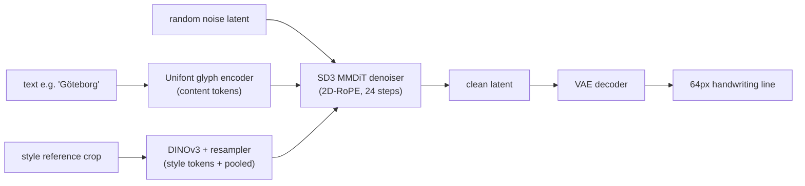
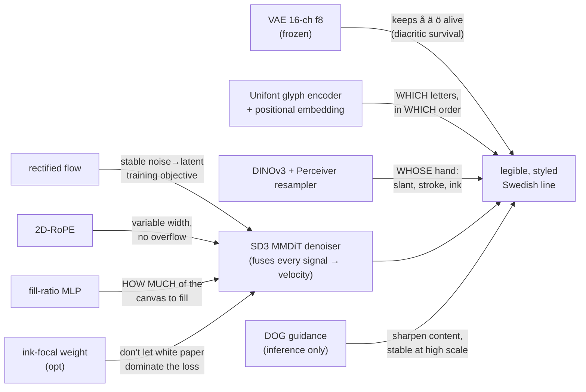
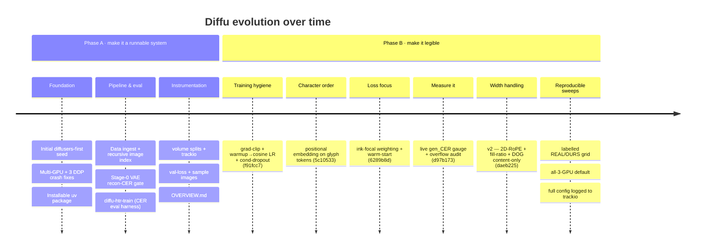
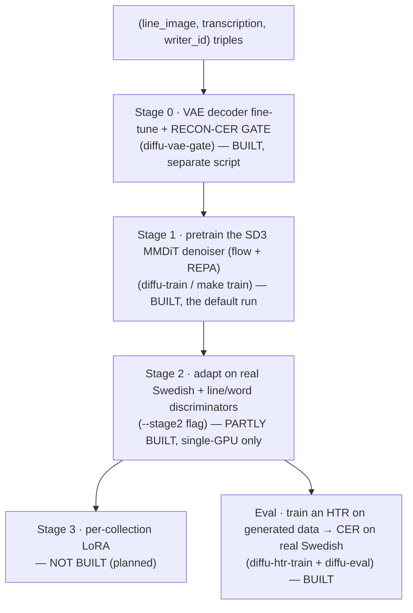

> ⚠ **FROZEN 2026-06-22 — historical record.** Current state: [`docs/STATUS.md`](../STATUS.md).
> Subsystems described below (DOG guidance, Stage-2 discriminators, CANINE, recog-loss) were later removed.

# Diffu — Progress & Architecture Audit

> **What this document is.** A pedagogical, code-exact audit of where Diffu is, how every
> layer works *today*, what we changed to make it viable, and *why* each change was made.
> Every claim below is grounded in the actual source (file references included), not the
> aspirational design. Read alongside [`ARCHITECTURE.md`](../ARCHITECTURE.md) (the vision) and
> [`STATUS_AND_PLAN.md`](STATUS_AND_PLAN.md) (the plain-language status, frozen alongside this file).

---

## ⏱ Status — updated 2026-06-22 · night (supersedes the evening block below)

**🎯 Classic CFG is a major legibility + text-following lever — DOG retired.** N=64 honest sweep on the
coherent base (`exp_base_weekend/step_360000` EMA): **gen_cer 0.51 (unguided) → 0.16 (cfg 3) → 0.14 (cfg 8)**,
ctrl_gap +0.90 → +1.31. Sweet spot **cfg 3–4.5** (~0.15–0.16). On the *single-domain* model this approaches
a strong ~0.086 target and crushes the old ~0.60 plateau — **the model CAN follow text; it just needed working
guidance** (DOG was broken at 0.95 and hid this for the whole project). Full table in EXPERIMENTS.md.
- **Wired:** classic CFG in `diffu.py` (`v = v_uncond + s·(v_cond−v_uncond)`, content dropped / style kept —
  uses the trained `--cond/--text-dropout`); `app.py` + `generate` CLI default 3.0; DOG relegated; training
  eval logs **`gen_cer_cfg`** (cfg 3.0) in place of the dead `gen_cer_dog`.

**Discriminator → built the real attention word-critic.** The first warm-started run (`exp_stage2_disc`,
**placeholder PatchGAN** word-critic) went **flat** — unguided gen_cer didn't bend (0.59→0.67 noisy);
d_loss fell but the generator improved *texture, not correctness* (the PatchGAN rewards "looks real," not
"right word"). So we **replaced it with the real attention word-critic** (`discriminators.py`: conv stem →
per-column word-region tokens → **RoPE self-attention** (reuses `build_2d_rope`'s shared-column scheme —
same as the glyph-line) → per-region real/fake logits, conditioned on the guidance). Smoked (unit + 2-GPU
DDP/bf16). **Now running overnight: `exp_stage2_wordcritic`** — warm-started from the coherent base, the
*real* multi-scale critic (line 3D-CNN + RoPE word-critic), 2-GPU DDP, batch 16, lr 5e-5; logs `gen_cer`
(unguided) **and** `gen_cer_cfg` (guided). **Verdict ~tomorrow: does gen_cer bend below ~0.59 / gen_cer_cfg
below ~0.16?** Still a *bonus* lever (CFG already won). Word-critic code **uncommitted**.

**→ NEXT — the scale-up (agreed):** multilingual **HTR+OCR** pretrain (~10M lines, bigger model, from
scratch, CFG-dropout on) → **Swedish historical fine-tune** → optional discriminator polish. **Gate: a small
curriculum pilot first.** Need 3 data facts (languages, HTR/OCR split, format). (Details lived in
TODO.md, since deleted — superseded by `../PERF_AUDIT.md` + `../RL_PLAN.md`.)

**Uncommitted:** CFG sampler + app/CLI + `gen_cer_cfg` + doc/string fixes.

---

## ⏱ Status — updated 2026-06-22 · evening (supersedes the 06-22 block below)

**Content-path A/B RESOLVED → pivoted to the correctness-signal experiment.**

- **A/B verdict (`exp_concat_cfg` vs `exp_line_cfg`, ~64k steps, apples-to-apples):** `--glyph-line`
  (cross-attention content) **decisively beats** `--glyph-concat` (channel-concat) — gen_cer 0.73 vs 0.80
  (Welch t=−5.9), ctrl_gap +0.047 vs +0.003 (t=+4.8), gap widening, mechanistically + visually confirmed.
  **BUT neither follows the requested text** (verified by eye — line writes legible-but-WRONG Swedish;
  concat decays to number-salad, e.g. "1021 mkr — 2 — mkr — 10"). So the A/B settled the *plumbing*
  (use glyph-line), **not** the *cure* (instruction-following). Both arms STOPPED 06-22.
- **Why concat loses:** an aligned channel-concat only works when the glyph image is rendered at the text's
  **target pixel positions** (bbox-fit + ControlNet-style position control); our uniform 32px/char monospace
  strip is not position-controlled. Stroke/online (1-D) approaches with fill-to-length tokens + self-attention
  are **not** a precedent for our 2-D image concat either. So fixing concat = building position control we
  don't need (attention already does it). **Concat dropped.**
- **The weekend run was NOT a wrong glyph-line:** byte-identical glyph-line/RoPE code to the A/B line arm
  (all cross-attention fixes `5c10533`/`daeb225`/`e2a3a71` predate it). It differs only by dropout (off) +
  effective batch (96 vs 64). So `exp_base_weekend/step_360000` is a valid, *more coherent* base.
- **Guidance:** DOG is broken at inference (gen_cer_dog 0.95 ≫ raw 0.73) → switching to **classic CFG**;
  this also finally makes the trained `cond/text-dropout` usable. *(TODO)*
- **Stage-2 discriminator IS DDP** (commit `0d3cdd5`) — **confirmed working on a 2-GPU smoke** (the
  "single-GPU only" docstrings were stale; fixed `train.py:407/823`).

**→ NOW RUNNING: `exp_stage2_disc`** — the warm-started content discriminator, the
**first direct attack on instruction-following**. `--init-from exp_base_weekend/step_360000/ema_model.safetensors
--glyph-line --no-style-tokens --ink-focal --stage2`, 2-GPU DDP, batch 16, lr 5e-5, content_weight 0.05.
**Decisive watch: does gen_cer drop below ~0.60 AND ctrl_gap climb meaningfully** (the base is now coherent —
the precondition grounding/discriminators need). Queued levers: classic CFG; non-Swedish data diversity;
the attention word-critic (current word disc is a PatchGAN placeholder).

---

## ⏱ Status — updated 2026-06-22 (supersedes 06-18 below)

**Weekend base run `exp_base_weekend` finished its useful life (~414k/500k, stopped 06-22). Verdict:
coherent cursive, still illegible, and MILDLY OVERFITTING — not usable for HTR augmentation.**

- **gen_CER plateaued ~0.60** (50k-window avg flat from ~150k → 414k; noisy min 0.49 @348k). ~6× the
  ~0.086 single-domain target, ~37× real (~0.016). The texture convinces; the text does not read.
- **Honest train/val correction (supersedes the earlier "stable, no overfit" claim — that was wrong).**
  On a log y-axis the TRAIN curves keep falling the whole run (flow_loss min **0.0338 @ the last step 410k**;
  total loss −7.1% over 200k→410k), but **val_loss bottomed early at 0.0788 @ step 134k and then drifted
  UP to ~0.087** (+1.9% over 200k→410k). The **train/val gap widens monotonically ~0 → ~0.011** — a real,
  if mild, generalization gap. Best val @134k, best gen_cer @348k: **the final 400k checkpoint generalizes
  WORSE than ~320–360k** — if sampling from this run, use the mid checkpoint, not the last.
- **Reading:** more *steps* on `data_out_lejonet` were counterproductive past ~150–350k. Even 1.36M Swedish
  lines isn't diverse enough to keep generalizing → the lever is **stronger content coupling + more/diverse
  DATA**, not more steps. Stage-2 discriminator stays DEFERRED (gen_cer is not falling; critics-on-a-smudge
  are wasted — a discriminator needs a coherent generator to warm-start from).

**Incoming commits verified (06-22) before committing GPU-days — all GREEN:** pyrefly 0 errors · pytest
33 passed · NEW regression test `tests/test_grad_accum_gating.py` proves the EMA/step fix advances once per
OPTIMIZER step at grad_accum>1 (real `EMAModel` + `Accelerator`) · 3 forward/backward smokes (default,
`--glyph-concat`, `--glyph-line`) finite-loss · a real 2-GPU `--grad-accum 2` run passed val+sample with no
NCCL hang (DDP barrier works). The 4 pulled features (`--glyph-concat` channel-concat, `--text-dropout`
independent CFG gate, reverted `--style-dropout`, `ctrl_gap` metric) are fully applied + correct.

**→ Now running (06-22): the content-path A/B on `data_out_lejonet`, matched, single-GPU each.**
- `exp_concat_cfg` (GPU 0): `--glyph-concat --cond-dropout 0.1 --text-dropout 0.1 --no-style-tokens
  --ink-focal` — channel-concat content + CFG. The headline.
- `exp_line_cfg` (GPU 1): same but `--glyph-line` — cross-attention content, identical CFG.
Everything else held constant (batch 64, lr 1e-4, REPA on, logit-normal 0.0). **A vs B isolates the content
path** (concat vs attention); judge by **`ctrl_gap` > 0** (does it follow the text) and `gen_cer`, not loss.
GPU 2 left free (slot for a 3rd arm = concat without CFG, to complete the 2×2). If concat wins → scale that
recipe on a larger, more-diverse corpus (non-Swedish pretrain → Swedish fine-tune).

---

## ⏱ Status — updated 2026-06-18 (supersedes 06-17 below)

**Root cause found + fixed: the model was copying the STYLE reference and ignoring the text.**
Confirmed two ways: (a) the `brave-forest-1` overfit converges fast but only *memorises* (val ⊆ train +
style-leak — not a capability proof); (b) in `app.py`, a style image + ANY new text generates the style
image's content, not the requested text. Mechanism (code-exact): `StyleEncoder` emits **64 spatial style
tokens** (`conditioning.py` PerceiverResampler over frozen DINOv3 patches) that were **concatenated into
the SD3 joint-attention context** (`diffu.py:106`). 64 attendable spatial tokens carry the reference's
glyph SHAPES → the image patches copy them → the text/glyph path atrophies. The fix is to avoid this by
construction: inject a global, metric-learned, mean-pooled writer vector at the timestep embedding, with
**no** copyable spatial style tokens in cross-attention.

**Fixes landed (this session):**
1. **Style self-exclusion** — `dataset._style_index` never returns the target line, so the style ref is
   always a *foreign* line (matches inference; kills the train-time content leak).
2. **`--no-style-tokens` / `cfg.cond.style_in_context=False`** — inject style **only as the global pooled
   AdaLN vector**, dropping the 64 copyable tokens from joint attention. Reversible
   flag (default True = legacy). Audited GO: shapes / DOG / cond-dropout / EMA all correct, no dead code,
   **no backbone change**. Real-data smoke-passed.
3. **Honest live eval** — after (1) the sample/gen_CER batch asks for text A while the style ref shows a
   *different* text B, so a copy renders B and `gen_CER`-vs-A spikes — it now measures **instruction-
   following, not reproduction**. The grid + trackio caption show `style ref wrote: B → want: A →
   read: <HTR>` so copying-vs-following is legible from the PNG alone. (`dataset.py`, `collate.py`, `train.py`.)

**New dataset — GT-Lejonet (`data_out_lejonet/`):** 1,648,007 polygon-masked 64px line crops,
**1,359,213 / 123,829 / 164,965** train/val/test, **volume-disjoint (leak-free)** split, 53.3M chars,
**56 collections / 226 volumes** (~4.6× the old single-collection `data_out`, far more diverse + cleaner).

**Known follow-up (flagged, not yet fixed):** `generate.py`/`app.py` rebuild a fresh `Config()` (so
`style_in_context` defaults True) and load only weights — a `--no-style-tokens` checkpoint would silently
run with style tokens back IN at inference. Persist the train cfg beside the ckpt + load it before serving
a pooled-only checkpoint. Does NOT affect training or the live gen_CER (both use the in-memory model).

**Next: 3-GPU A/B/C on `data_out_lejonet` (all `--glyph-line`, honest eval):**
- A (control) `--glyph-line` — style tokens still IN → confirms it still copies/ignores text.
- B (fix) `--glyph-line --no-style-tokens` — does killing the copy-highway force text-following? (decisive)
- C (fix+low-noise) `--glyph-line --no-style-tokens --logit-normal-mean -0.5` — sharper letter detail?

Decisive read: held-out `gen_CER` on B/C drops vs A, and the swap-text grid visibly writes the **requested**
text, not the style's. If yes → multi-day run on full 1.36M; if nothing moves → strengthen the content path.

**RESULT (later 06-18): A/B/C ran on GT-Lejonet — marginal collapse CONFIRMED; the style-token fix is
necessary but NOT sufficient.** gen_CER stayed flat ~0.78–0.81 across all three (steps 1k→5k) while the
flow loss floored ~0.08–0.12 — the loss-vs-legibility decoupling, same as the old single-collection run.
`exp_B` (pooled-only) was marginally better than `exp_A` (control) — the fix stopped the *copying* — but
neither learns to spell, because **nothing in the loss rewards legibility.** The image/style look
plausible; only the TEXT is gibberish (style fidelity is now also weak, since style is a single global
vector after dropping the tokens).

**→ Built the recognizer grounding loss (the missing signal).** A FROZEN TrOCR
(`Riksarkivet/trocr-base-handwritten-hist-swe-3`, 192×1024) reads `vae.decode(x0_pred)` and we add its
teacher-forced CE vs the REQUESTED text — differentiable w.r.t. the image, so the gradient flows into the
generator and "spell it right" finally lowers the loss. Gated to low-noise timesteps (readable x0_pred) +
warmed up from 0, so it **self-warm-starts** (flow-only first, grounding after — no external checkpoint
needed). Frozen → excluded from trainable params/EMA. Files: `config.py`
(`recog_loss_weight`/`recog_warmup_steps`/`recog_max_t`/`htr_recognizer_train`), `recognizer.py`
(`RecognitionLoss`), `model/diffu.py` (`self.recog` + `recog_weight` in forward), `train.py`
(`--recog-loss-weight`, `--recog-warmup-steps`). Eval recognizer also switched to the base model per
request — NOTE: same model for loss+eval makes the recog arm's gen_CER optimistic; read with that caveat.

**Next 3-arm (all `--glyph-line --no-style-tokens`, from scratch, `--save-every 2000`):** control (no
grounding) · `--recog-loss-weight 1.0` · `--recog-loss-weight 3.0`. Decisive: does gen_CER drop off the
~0.78 floor once the recognizer loss is on? After legibility, the next lever is **style fidelity**
(multi-shot + metric-learned pooled style). Warm-started discriminator deferred (it
needs a legible checkpoint to start from, which a successful recog run will provide).

**UPDATE (06-18 evening): the recog grounding FAILED → pivoted to a weekend base run.**
A/B/C confirmed the style-token fix is necessary-not-sufficient (gen_CER flat ~0.78, marginal collapse).
Then D control / E `--recog-loss-weight 0.25` / F `--recog-loss-weight 1.0`: the recognizer-CE grounding
**actively HARMED** the model — `recog_loss` flat ~3.4 (it dominates the loss but the generator can't
reduce it = useless gradient), images degraded to white/speckle, gen_CER got WORSE, F's total loss climbed
3.9→4.5. The frozen-OCR CE gradient through a noisy decoded `x0_pred` is a poor/harmful guidance signal: a
CTC/OCR loss flattens style and is worse than a discriminator, and grounding only helps as a late polish on
an **already-coherent generator**, not from scratch.
**Grounding is a polish on a coherent base, not a from-scratch teacher.**

**→ Weekend base run `exp_base_weekend`** (DDP × 3 GPUs, `--glyph-line --no-style-tokens --ink-focal`,
batch 96, `--steps 500000` ≈ ~430k by Mon ≈ ~30 epochs, `--save-every 40000`, **NO grounding**, LR
warmup(2000)→cosine→1e-6, base 1e-4). It tests the prerequisite: **does the from-scratch base, trained for
real, reach coherent handwriting** (gen_CER off the ~0.77 floor)? Monday: if yes → add Stage-2 (warm-started
discriminator) on the latest checkpoint; if still flat → the base/prior is the wall
(conv inductive bias or pretrained SD3 init), not another loss.

---

## ⏱ Status — updated 2026-06-17 (supersedes stale claims below)

**Where we are:** the architecture is built + runtime-validated; a fresh from-scratch **Stage-1 run is
training now** (trackio `silly-flower-15`: batch 64 × 3 GPUs, REPA + `cond_dropout 0.1` + `ink-focal`,
white-pad 0.3, **Stage-2 OFF**). Verified since the original audit:

- **Stage-0 VAE gate = PASS** — the frozen Qwen 16-ch latent preserves `å ä ö` (raw 0.02 / recon 0.02 /
  gap −0.002 with the strong Swedish-Lion + `trim_to_ink`, confirmed visually). **The latent is NOT the floor.**
- **Recognizer standardized** on `trocr-large-hist-swe-3-char` everywhere (+ `trim_to_ink` → honest CER;
  real lines read at ~1.6%). An earlier 0.42 "raw CER" was a batch-padding artifact, now fixed.
- **Stage-2 discriminators wired for DDP** (separate G/D modules + `no_sync` alternating updates) —
  validated on 2 and 3 GPUs. Still the *late, unproven* lever: the word-disc is a PatchGAN placeholder
  with no validated precedent.
- **trackio** now logs the full experiment config + an explicit `stage` label (stage0/1/2) +
  `g_loss`/`d_loss`; default batch is **64** (~45 GB, 144 img/s on 3 GPUs).

**NEW — line-level glyph content + shared-column RoPE (`--glyph-line`, default OFF, EXPERIMENTAL/untested).**
The default content path is **per-character** tokens. Added an opt-in **line-level** path — the whole line
rendered as one glyph image → ResNet feature map — that goes one step further with the
Qwen-Image **MSRoPE** idea:
- `GlyphLineContentEncoder` renders the **whole line as one image** → (ImageNet-pretrained) ResNet18
  **feature map** → pooled to height 1 and resampled to **exactly `w_t` (image patch-column) tokens**, so
  content token *j* ↔ image column *j*.
- the backbone builds a **shared-column 2D-RoPE** for those `n_content` tokens (`build_2d_rope(1, w_t)`),
  and `RoPEJointAttnProcessor` rotates the first `n_content` text tokens with it — so the image attends
  to the glyph **at its own column** (text↔position alignment for free; style tokens stay position-free).
- This removes the alignment-learning burden of per-char cross-attention (a likely contributor to
  "looks like writing, spells nothing"). It is **static-verified only** (pyrefly 0 errors); needs a GPU
  smoke (`make smoke-1gpu` / `diffu-train` with `--glyph-line`) before trusting it. Files:
  `model/content_encoder.py`, `model/rope.py`, `model/backbone.py`, `model/diffu.py`, `config.py`,
  `train.py`, `smoketest.py`. → **TO VALIDATE NEXT SESSION** (checklist lived in TODO.md, since deleted) (smoke
  `--glyph-line`, then A/B `gen_cer` vs per-char; if it wins, flip the default + delete the per-char path).

**Key correction:** legibility is driven by **scale
(~1000–2000 epochs) + a content-DECOUPLED, handwriting-specific style encoder** — *a discriminator is not
the primary lever.* Consequences for the claims below:
- **§4.2 / §9 overstate the glyph positional embedding as "the headline legibility fix."** It is
  *necessary but not sufficient* — the run had it and is still illegible. The real levers are **scale +
  `cond_dropout` (make content load-bearing) + a decoupled style path**, not char-order alone.
- **§7's "synthetic Stage-1" is not our reality.** We have **no synthetic data**: Stage 1 trains on the
  **real** corpus; every stage shares one writer/volume-disjoint split — only the *objective* changes.
- The **discriminator (Stage 2) is the last lever**, enabled only after `gen_CER` is clearly falling —
  not the primary fix.

---

## 0. The goal and the one metric that matters

Diffu turns **typed text + a style sample → a realistic Swedish handwriting line-image**
(modern *and* historical, including `å ä ö Å Ä Ö ſ`). The point is to **mass-produce labelled
synthetic handwriting** so we can train better **HTR** (handwriting recognition) models.

The only success metric is **downstream Character Error Rate (CER)** — does a recognizer read
our generated lines back as the correct text, and does training an HTR model on our fakes lower
its error on *real* Swedish? **Not** FID, not "looks pretty." This single fact explains almost
every design choice that follows.

---

## 1. The mental model (how a generation works today)

We never paint pixels directly — too big, too slow. Instead:

1. **Compress** a `64×W` line image into a small latent with a **VAE** (16 channels, 8× smaller).
2. A transformer **denoiser** turns **noise → a clean latent**, *guided* by **what** to write
   (glyph content tokens) and **how** to write it (style tokens from a reference hand).
3. **Decompress** the latent back to an image with the VAE decoder.



"Diffusion" is just the noise→clean part. Everything else is **conditioning** (telling it
what/how) and **supervision** (making it correct).

### 1.1 What each component contributes (and what breaks without it)

Every box below earns its place by supplying **one signal** the final image needs. The edge label
is its contribution; the failure mode (what the smudge looks like if it's missing or broken) is in
the table beneath.



| Component | Contributes | If missing / broken |
|---|---|---|
| VAE (16-ch f8) | a latent that *preserves* sub-8px diacritic marks | `å`-ring / `ä-ö` dots blur away — unrecoverable downstream |
| Unifont glyph encoder | letter identity **and order** (with the pos-embedding) | realistic cursive **texture that spells nothing** (the smudge) |
| DINOv3 + resampler | writer style: slant, stroke width, ink, ligatures | content right, but generic/averaged hand |
| SD3 MMDiT | the actual denoiser that fuses all signals | — (it *is* the model) |
| Rectified flow | a stable, few-step objective | slower, noisier convergence (vs old DDPM) |
| 2D-RoPE | native variable-width handling | short text smeared across a wide canvas (overflow) |
| Fill-ratio MLP | how much of a wide canvas to occupy | hallucinated tail of fake ink past the real text |
| Ink-focal (opt) | gradient focus on sparse ink vs paper | background dominates loss; letters learn slowly |
| DOG (inference) | content sharpening without CFG's high-scale artifacts | OOV words stay mushy at usable guidance strength |

---

## 2. The architecture *as it actually runs today*

Below is what the **default `Config`** (`src/diffu/config.py`) builds and what
`Diffu.forward` / `Diffu.generate` (`src/diffu/model/diffu.py`) actually execute. Where a
component exists in the tree but is **off by default**, that is stated explicitly — this is the
gap between the vision doc and reality.

| Layer | File | Default state | Trained? | Notes |
|---|---|---|---|---|
| VAE (Qwen-Image, 16-ch f8) | `model/vae.py` | **active (frozen)** | encoder frozen; decoder is Stage-0 | encode is `no_grad`; decode only at sample/generate |
| Unifont glyph content encoder | `model/content_encoder.py` | **active** | **yes** | the *primary* "what to write" path |
| CANINE text encoder | `model/conditioning.py` | **off** (`use_canine=False`) | n/a | scaffolded, not wired into `forward` |
| Glyph-line strip → latent | `model/conditioning.py` | **off** (renderer used only for Stage-2/guidance) | n/a | channel-concat geometry lock not wired |
| DINOv3 style + Perceiver resampler | `model/conditioning.py` | **active** | DINOv3 frozen, resampler **trained** | falls back to DINOv2-with-registers if DINOv3 is gated |
| Fill-ratio AdaLN conditioning | `model/diffu.py` | **active** (`fill_ratio_cond=True`) | **yes** (tiny MLP) | tells the model how much of the canvas to fill |
| SD3 MMDiT denoiser | `model/backbone.py` | **active** | **yes** (dominant cost) | dim 1024, 24 layers, 16 heads, patch 2 |
| 2D-RoPE | `model/rope.py` | **active** (`rope=True`) | no params | replaces SD3's absolute position table |
| Rectified-flow objective | `flow.py` | **active** | no params | `v = eps − x0` |
| Ink-focal loss weighting | `model/diffu.py` + `flow.py` | **off** (`--ink-focal`) | no params | up-weights sparse ink cells |
| REPA alignment (token-wise) | `flow.py` + `model/diffu.py` | **on** (`--no-repa` to disable) | tiny proj head | aligns DiT per-token hidden states to DINO per-patch features |
| DOG guidance (content-only) | `sampling/dog.py` | **active at inference** | no params | sampling-time, training-free |
| Line/word discriminators | `model/discriminators.py` | **off** (`--stage2`, 1-GPU only) | yes (adversarial) | Stage-2 legibility critics |

### 2.1 VAE — `model/vae.py`
- **What:** compresses `64×W×3` → a `16 × 8 × (W/8)` latent and back. Two halves: encoder
  (image→latent) and decoder (latent→image).
- **Why this exact VAE:** diacritics are the whole game. On a 64px line an `å`-ring is sub-8px;
  a 4-channel SD1.5 VAE smears it and *nothing downstream can recover it*. So we use a **16-channel,
  f8 (only 8× spatial shrink), text-tuned** VAE (`Qwen/Qwen-Image`, Apache-2.0, ungated). A
  **hard recon-CER gate** is the contract: round-trip a real line through encode→decode, run HTR,
  and refuse to start diffusion training until reconstruction CER is within `+0.5` of raw CER
  (`recon_cer_gate=0.5`).
- **Learnable?** **Encoder frozen, decoder fine-tuned** on Swedish ink (Stage 0). In Stage-1
  training the *whole* VAE is frozen — `forward` only `encode`s (no-grad), never decodes.

### 2.2 Unifont glyph content encoder — `model/content_encoder.py` (the "WHAT")
- **What:** renders **each character to a 32px GNU-Unifont bitmap** (Unifont covers the full BMP,
  so every Swedish/historical glyph has a picture), runs a **ResNet18 stem** per glyph, adds a
  **learnable positional embedding**, then a **2-layer Transformer** → content tokens `[B, L, 1024]`.
- **Why:** this *guarantees rare-glyph coverage by construction*. Even a glyph never seen in real
  handwriting has a correct-shape picture the model can copy in the target style.
- **Learnable?** **Yes** (CNN + positional table + Transformer). The Unifont bitmaps are fixed.
- ⚠️ **The positional embedding is load-bearing** — see §4.2. Without it the token set was
  permutation-invariant and the model could not place characters *in order*.

### 2.3 DINOv3 style encoder + Perceiver resampler — `model/conditioning.py` (the "HOW")
- **What:** runs 1–5 reference crops through **DINOv3 ViT-L** (frozen), then a **Perceiver
  resampler** squeezes the many patch features into a fixed **64 style tokens + a pooled vector**.
- **Why:** style = slant, stroke width, ligatures, ink texture. DINOv3 is the strongest general
  encoder for fine texture; the resampler gives the denoiser a fixed-size style code regardless of
  how many/large the reference crops are.
- **Pooling:** the AdaLN style vector comes from a **learned-query attention pool** (`AttentionPool`),
  not a plain token mean — a content-aware summary that keeps the discriminative cues instead of
  averaging them away.
- **Learnable?** **DINOv3 frozen; resampler + attention-pool trained.** Loads `facebook/dinov3-vitl16-…`,
  falls back to `facebook/dinov2-with-registers-large` (Apache-2.0) if DINOv3 is gated.

### 2.4 SD3 MMDiT denoiser — `model/backbone.py` (the brain)
- **What:** a `diffusers` `SD3Transformer2DModel` (MMDiT), **not hand-rolled** — we get SDPA/
  FlashAttention, gradient checkpointing, and `torch.compile` for free. We only *wrap* it to map
  our conditioning:
  - `hidden_states` = noised latent `[B,16,h,w]`
  - `encoder_hidden_states` = `concat(content tokens, style tokens)` `[B, L+64, 1024]` (joint attention)
  - `pooled_projections` = pooled style (+ fill-ratio) vector → AdaLN modulation
  - `timestep` = flow timestep (scaled ~`[0,1000]`)
  - **output** = predicted velocity `[B,16,h,w]`
- **Why a transformer, not a U-Net:** it handles **variable-length lines natively**
  (via 2D-RoPE), conditioning fuses cleanly through attention, and it's the proven 2026 latent-
  diffusion backbone (SD3/FLUX/Qwen all moved U-Net → MMDiT).
- **Learnable?** **Yes** — `dim=1024, num_layers=24, heads=16, patch=2`, the dominant trainable cost.

### 2.5 2D-RoPE — `model/rope.py` (variable-width fix)
- **What:** with `rope=True` (default) we **delete SD3's absolute sincos position table** (and its
  `pos_embed_max_size` width cap) and instead rotate the **image** Q/K with a relative **2D rotary
  embedding** (rows + columns, row-major to match `PatchEmbed`). Text tokens stay position-free
  (they're a set, and the glyph encoder already injects character order).
- **Why:** our lines are **variable-width**. An absolute table has to *extrapolate* off-table for
  wide lines — the root cause of the "short text smeared across a wide canvas" overflow. RoPE is
  relative, so width is no longer capped or mis-encoded.

### 2.6 Rectified flow — `flow.py` (the objective)
- **What:** interpolate `x_t = (1−t)·x0 + t·eps` and train the DiT to predict the **velocity**
  `v = eps − x0`. Sampling integrates that velocity from noise (t=1) back to data (t=0) with
  `FlowMatchEulerDiscreteScheduler`. Timesteps are sampled **logit-normal** to emphasize the hard
  mid-range. **No parameters** — it's a loss recipe.
- **Why:** modern, stable, fewer sampling steps and higher quality than old DDPM ε-prediction.

### 2.7 DOG guidance — `sampling/dog.py` (inference only)
- **What:** Dual Orthogonal Guidance (ICCVW 2025). At each sampling step it builds a *negatively
  perturbed* conditioning, removes the component aligned with the positive prediction (orthogonal
  projection), and steers away from that "bad" direction, on a **triangular schedule** (weak at the
  ends, strongest mid-trajectory).
- **Why & the recent fix:** a smarter, more stable replacement for classifier-free guidance that
  doesn't fall apart at high scale. Crucially it perturbs the **content tokens only**
  (`context[:, :n_content]`), leaving style untouched — so it sharpens *what* is written without
  corrupting *whose hand*. **No parameters, no training.**
- **One sampler:** DOG lives as reusable *primitives* (`perturb_condition`, `dog_guidance`,
  `triangular_schedule`) used by the **single** sampler in `Diffu.generate`. (A second, unused
  hand-rolled Euler `dog_sample` was removed — it duplicated and diverged from the real sampling
  path, which integrates with the diffusers scheduler.)

---

## 3. How the layers cooperate in one training step

`Diffu.forward` (`model/diffu.py`) is the whole Stage-1 step:

```mermaid
sequenceDiagram
    participant B as batch (image, text, style ref)
    participant V as VAE encoder (frozen)
    participant F as rectified flow
    participant C as conditioning
    participant D as SD3 MMDiT
    B->>V: encode image -> x0  (no_grad)
    F->>F: sample t (logit-normal); x_t=(1-t)x0+t·eps; target_v=eps-x0
    B->>C: glyph encoder(text) -> content; DINOv3+resampler(ref) -> style,pooled
    B->>C: fill_ratio from target ink -> added to pooled
    C->>D: context=[content; style], pooled
    D->>D: predict velocity v from (x_t, t, context, pooled)
    D->>F: flow_loss = MSE(v, target_v)   (optionally ink-weighted / +REPA)
```

Key details that are easy to miss:
- **Conditioning order is `[content, style]`** so the first `n_content` tokens are content — the
  exact split DOG perturbs at inference.
- **Fill-ratio** is computed from the *target image's* rightmost inked column at train time, and
  from the *natural text width* at inference (same formula), so the model is told "this text fills
  X% of this canvas — leave the rest blank" instead of hallucinating a tail.
- **`cond_dropout`** (when enabled) zeroes context+pooled per-sample so the model learns an
  unconditional mode (enables CFG-style guidance).

---

## 4. Architecture evolution — what we changed and *why* (commit by commit)

The history splits cleanly into **(A) build the scaffolding**, then **(B) diagnose & fix "it
trains but writes a smudge."** That second arc is the heart of "make it actually work."



### Phase A — make it a real, runnable system
| Commit | Change | Why it mattered |
|---|---|---|
| `cb60388` | Initial diffusers-first Swedish generator | the seed: latent diffusion + few-shot style + content conditioning |
| `9301857`, `d77d8be` | Multi-GPU runnable; fix 3 DDP crashers | DDP hangs on step 1 if any built param never gets a gradient → we freeze everything Stage-1 doesn't touch |
| `2ef8bfd` | Restructure into an installable `uv` package | reproducible env, CLIs (`diffu-train`, `-generate`, `-eval`, …) |
| `71d34e6` | Tests + eval/generate CLIs + **optional** REPA & Stage-2 discriminators | the optional advanced losses land as flags, **off by default** |
| `b829719` | `diffu-vae-gate` (Stage 0) + TrOCR meta-tensor fix | enforce the diacritic-survival contract before any diffusion |
| `f64c6ce`, `cee4bdc`, `419ca1f` | Ingest pre-cropped lines, recursive image index, source recipe | the data pipeline that turns Riksarkivet PAGE/ALTO into line triples |
| `a999a81` | `diffu-htr-train`: TrOCR fine-tune harness | the *evaluation* half — train an HTR on our fakes, measure CER |
| `4effbb6`, `3c59a65`, `2f64c2a`, `cbe543a` | volume splits, trackio logging, Gradio picker, val-loss + sample images | instrumentation so we can *see* whether it's learning |
| `6b1a462` | `docs/OVERVIEW.md` | plain-language explainer |

At the end of Phase A the machinery was **verified working**: loss fell `2.0 → ~0.08`, and
held-out `val_loss` matched train loss (`≈0.107 vs ≈0.107`) — *learning the skill, not memorizing*.
But the generated words were an **illegible smudge**: realistic cursive texture, no real spelling.

### Phase B — the "make it legible" arc

The smudge had three suspected causes (see `STATUS_AND_PLAN.md §5`): trained from scratch, **no
character-order signal / no legibility signal**, and a learning-rate schedule bug. The commits
below attack each.

| Commit | Change | The "why" |
|---|---|---|
| `f91fcc7` | **grad-clip + warmup→cosine LR + cond-dropout** | From-scratch generators don't converge on a constant LR; standard training hygiene fixes the LR-schedule bug and adds CFG capability. |
| `5c10533` | **Positional embedding on glyph content tokens** | **The likely real cap on legibility.** The glyph tokens went through a *permutation-invariant* Transformer and SD3 adds no position to `encoder_hidden_states` — so the model had **no signal for which glyph goes where**. Verified: `'abc'` and `'cba'` now produce different content tokens. Texture-without-letters is exactly the symptom of missing order. |
| `6289b8d` | **Ink-focal loss** + `--init-from` warm-start | ~90% of a line is white paper; an unweighted velocity MSE lets the background dominate and starves letter learning. Up-weight sparse ink cells. Warm-start avoids re-paying the from-scratch cost. |
| `d97b173` | **Live `gen_CER` gauge** (recognizer + trim-to-ink) + overflow audit + scripts | Stop eyeballing. Read our own samples back with the Swedish-Lion HTR every `sample_every` steps → a real legibility number on the dashboard. Also audits the short-text-on-wide-canvas overflow. |
| `daeb225` | **v2 architecture**: 2D-RoPE + width/fill-ratio handling + DOG content-only fix | Fix the overflow at its root (drop the absolute position table for RoPE), tell the model how much canvas to fill (fill-ratio), and make DOG perturb content only. |
| `736bef4`, `ad3d7d0`, `41a8d80` | Label the REAL/OURS sample grid; all-3-GPU default; **log full experiment config to trackio** | Make runs self-explanatory and **comparable by every knob** (batch, LR, rope, fill-ratio, white-pad, grad/LR) so the sweep that finds legibility is reproducible. |

### 4.1 Why the LR/grad-clip change (`f91fcc7`)
Constant LR from random init is hard to converge; the standard fix is to
**warm up then cosine-decay** and **clip gradients to 1.0**. We added
`_warmup_cosine_min_lr` (decays to a `min_lr` *floor*, not 0, so late training still makes tiny
updates) and `accel.clip_grad_norm_`. A subtle multi-GPU bug is handled here too: accelerate's
prepared scheduler advances *once per process per step*, so we scale the horizon by
`num_processes` — otherwise an N-GPU run burns the whole schedule N× too fast and trains the tail
at ~0 LR. (This is the "LR bug" referenced in the status doc.)

### 4.2 Why the glyph positional embedding (`5c10533`) is the headline fix
This is the most important single change for *legibility*. A `TransformerEncoder` with no position
embedding is order-invariant; feeding it `[glyph_a, glyph_b, glyph_c]` vs `[glyph_c, glyph_b,
glyph_a]` produced **identical token sets**, and SD3 adds no position to the context tokens. So the
denoiser knew *which letters* to draw but not *in what order* — the textbook cause of "looks like
handwriting, spells nothing." Adding a learnable `pos` table (`content_encoder.py:81`,
`feats + self.pos[:, :ln]`) injects character order. Every reference model positions its content
tokens; we had silently dropped it.

### 4.3 Why RoPE + fill-ratio (`daeb225`) together
Two symptoms of the same disease — the model didn't understand the **canvas width**:
- **Overflow:** SD3's absolute position table is capped at `pos_embed_max_size` patches and must
  extrapolate for wider lines, smearing short text across a wide canvas. **Fix:** drop the table,
  use relative **2D-RoPE** (`rope.py`) so width is handled natively.
- **Hallucinated tails:** even with RoPE, the model needs to know *how much* of a wide canvas the
  text should occupy. **Fix:** the **fill-ratio scalar** (text-extent ÷ canvas-width) embedded into
  the AdaLN pooled vector — measured from target ink at train time, from natural text width at
  inference. Paired optionally with **white-pad augmentation** (train-only) that shows the model
  short text on a padded canvas so it *learns* to leave the tail blank.

---

## 5. Results — before vs. now (honest)

| Signal | Before Phase B | Now | Source |
|---|---|---|---|
| Train loss | `2.0 → ~0.08` | unchanged (machinery was never the issue) | `OVERVIEW.md` |
| `val_loss` vs train | `≈0.107 vs ≈0.107` (no memorization) | unchanged | `train.py: evaluate_val_loss` |
| Style realism | ✅ realistic Swedish cursive on aged paper | ✅ | `STATUS_AND_PLAN.md §5` |
| Content legibility | ❌ illegible smudge; words don't spell | targeted by char-order + ink-focal + width fixes; **now measured live by `gen_CER`** | `5c10533`, `d97b173` |
| Overflow (short text, wide canvas) | smeared across the canvas | addressed by 2D-RoPE + fill-ratio | `daeb225` |
| Measurability | "eyeball the sample strip" | **`gen_CER` number every `sample_every` steps** + labelled REAL/OURS grid | `d97b173`, `736bef4` |

**Bottom line:** the *machinery* is verified (loss converges, no overfitting, style is right). The
open problem was always **legibility**, and Phase B is a sequence of targeted, reference-grounded
fixes for it — with `gen_CER` now turning "is it working?" from a vibe into a number we can sweep
against. Whether the final output is *good enough to lower downstream HTR CER on real Swedish* is
answered only after a full run + the A/B HTR-training test; we are not there yet, but nothing is
broken and each fix is independently justified.

---

## 6. How we measure it now (the instrumentation)

Three live signals, all in trackio (`--track`) and on disk:
1. **`loss` / `flow_loss` / `repa_loss` / `lr` / `images_per_s`** — every `log_every` steps. `loss` is
   the optimized total; `flow_loss` and `repa_loss` are the components logged separately.
2. **`val_loss`** — every `val_every` on the volume-disjoint val split. Rising while train falls =
   memorization. (`evaluate_val_loss`)
   - **Why REPA isn't in val (the apples-to-apples fix):** REPA is a **training-only** representation
     regulariser — in eval it has no gradient and would only muddy the metric, so `forward` skips it
     when `not self.training`. That means the *total* train `loss` includes REPA but `val_loss` does
     not. To keep the overfitting check honest we log the **`flow_loss`** term separately: the real
     comparison is **train `flow_loss` vs `val_loss`** (both pure flow), not the REPA-inclusive total.
3. **`gen_CER` (± DOG) + REAL/OURS sample grid** — every `sample_every`. Generate held-out lines,
   read them back with the **Swedish-Lion** HTR (`Riksarkivet/trocr-large-handwritten-hist-swe-3-char`),
   and log the CER plus a captioned `want 'x' → read 'y'` grid. (`save_samples` + `recognizer.py`)
   - The visual grid uses `dog_scale=0` (high DOG over-saturates an undertrained model to white,
     hiding true progress), and `gen_cer` is the **no-DOG** number.
   - A **second**, DOG-guided generation (`gen_cer_dog`, at `cfg.dog.base_scale`) is logged alongside
     it, so we can *see* whether DOG actually lowers CER here instead of assuming it — the missing A/B.

The full run config (batch, effective-batch, LR, warmup, rope, fill-ratio, white-pad, grad-clip,
ink-focal, …) is logged so any two runs are comparable knob-for-knob (`41a8d80`).

---

## 7. The training workflow — what "Stage 0/1/2/3" means (it's **4 stages**)

**First, the key clarification:** "stages" are **not** a single program that runs end-to-end. They are
a **training *curriculum*** — a planned sequence of **four** phases (0, 1, 2, 3). Each phase is a different
*entry point / flag*, and **only some are actually built today**. There is no `Stage 1 → Stage 2`
auto-orchestration; you run them yourself.

### Why split training into 4 stages at all? (the pedagogy)

Because the four phases solve **different sub-problems**, with **different data**, **different cost**,
and **different objectives** — and doing them in order (easy → hard, cheap → scarce, frozen →
adversarial) is what keeps training stable. Teaching analogy: you sharpen the camera *before* teaching
drawing; you practise on cheap scrap paper *before* using the one precious notebook; you add the harsh
critic *after* the student can already form letters. Concretely:

| Why this stage exists | Data it uses | Why it must come when it does |
|---|---|---|
| **0 · compressor must be sharp first** — everything downstream lives in the VAE's latent space; if `å`/`ä`/`ö` don't survive compression, **no** generator training can recover them | a little real ink | first — it's a hard *gate*; pointless to train a generator on a latent that already lost the diacritics |
| **1 · learn the general skill** — letterforms, stroke structure, the full charset | **synthetic** font-rendered lines (free, unlimited) | the big, expensive compute phase; uses *cheap* data so you don't burn scarce real data teaching basics |
| **2 · specialise + add the legibility critic** — adapt to *real* Swedish hands and turn on the discriminators | **real** Swedish (scarce, precious) | last-ish: real data is rationed for what only it can teach (true hands); adversarial critics are added late so they don't destabilise early training |
| **3 · per-collection polish** — a small LoRA for one archive's hand | ~tens–hundreds of lines | optional, cheap, after a good general model exists |

So the split is about **spending the right data and compute on the right problem at the right time**,
not bureaucracy. The scarce input (real transcribed Swedish) is saved for Stage 2/3; the expensive
compute (the big DiT pretrain) happens on free synthetic data in Stage 1; and Stage 0 is a cheap
one-time gate that protects the thing the whole project hinges on (diacritic survival).



| Stage | Plain meaning | How you run it | Status |
|---|---|---|---|
| **0** | Make the VAE *compressor* sharp enough that `å ä ö` survive; refuse to proceed until it does (the "gate") | `diffu-vae-gate` / `make vae-gate` — a **separate, manual** script | **gate = MEASURE-ONLY built**; the decoder **fine-tune is NOT implemented** anywhere, and `make train` **freezes the VAE** regardless — so Stage 0 changes nothing today |
| **1** | Teach the denoiser the *general* skill of writing, on lots of (cheap) data — this is the big run | `diffu-train` / `make train` — **the default** flow-matching loop | **built** (multi-GPU works) |
| **2** | *Adapt* to real Swedish hands and turn on the **discriminators** (the legibility critic) | the **`--stage2` flag** on that same loop | **partly built** — single-GPU only (§ DDP) |
| **3** | Optionally specialise to one archive/hand with a small LoRA | — | **not built** (planned) |

So: it's not "2 stages" — the *design* has **four** (0–3). But in practice **only Stage 1 is the
training you run by default**; Stage 0 is a separate pre-flight script; Stage 2 is an off-by-default
flag; Stage 3 doesn't exist yet. That is exactly why "Stage-1 DDP works but Stage-2 doesn't" — Stage 1
*is* the normal training (multi-GPU fine), and Stage 2 is the optional discriminator add-on that's
still single-GPU.

**Where this is documented:** the `train.py` module docstring ("Stages: 0) … 1) … 2) … 3) …"),
`ARCHITECTURE.md` §6, and this section. (It was *mentioned* but never explained plainly — hence this
rewrite.)

- **Eval** (`diffu-htr-train` + `diffu-eval` / `scripts/eval_cer.py`): the real verdict — train an
  HTR on our generated lines and measure CER on real held-out Swedish.

---

## 8. What's wired vs. scaffolded vs. optional (the exact truth)

To avoid the vision/reality gap that bites readers of `ARCHITECTURE.md`:

- **Wired & on by default:** VAE (frozen), Unifont glyph encoder (+positional embedding), DINOv3 +
  resampler + attention-pool, fill-ratio AdaLN MLP, SD3 MMDiT, 2D-RoPE, rectified flow,
  **REPA token-wise alignment** (`--no-repa` to disable), DOG (inference).
- **Wired but off by default (flags):** ink-focal flow (`--ink-focal`), cond-dropout/CFG
  (`--cond-dropout`), Stage-2 discriminators (`--stage2`, 1-GPU only), white-pad augmentation
  (`--white-pad-prob`).
- **Scaffolded, NOT wired into `forward` yet:** the **CANINE** content path (`use_canine=False`) and
  the **glyph-line strip → channel-concat** geometry lock. Both exist in `conditioning.py` but the
  default content path is Unifont-only; the glyph-line renderer is currently used only for Stage-2
  guidance images and inference width estimation.

---

## 9. One-paragraph summary

Diffu is a **latent rectified-flow diffusion model**: a frozen 16-channel VAE keeps diacritics
alive, a **trained SD3 MMDiT** denoises noise→latent guided by **Unifont glyph content tokens**
(what) and **DINOv3 style tokens** (how), and the VAE decodes the result. The system was runnable
and provably *learning* early on, but produced legible-looking texture with **no real spelling**.
The fixes that make it viable, in order of impact: **(1)** add the missing **character-order signal**
to the glyph tokens, **(2)** match reference **LR/grad-clip hygiene** so the from-scratch DiT
converges, **(3)** stop the background from dominating with **ink-focal weighting**, **(4)** fix the
variable-width **overflow** with **2D-RoPE + fill-ratio conditioning**, and **(5)** make all of it
measurable with a live **`gen_CER`** gauge so the remaining legibility work is a number-driven
sweep, not a guessing game.

---

## 10. Open gaps, recent fixes & recommendations

### 10.1 Just fixed (this audit branch)
- **One DOG sampler.** Removed the unused, divergent hand-rolled `dog_sample`; DOG is now reusable
  primitives + the single sampler in `Diffu.generate`. (`sampling/dog.py`)
- **`gen_CER` with *and* without DOG.** The gauge now logs `gen_cer` (no DOG) **and** `gen_cer_dog`
  (`cfg.dog.base_scale`) at each sample step, so DOG must *earn* its cost against the metric.
  (`train.py: save_samples`)
- **Longer text, cheaply.** Content tokens now pad to the **batch's longest text** (capped at
  `max_chars`) instead of always padding to the cap — so `max_chars` can be large without taxing
  short lines. Default raised `96 → 128`, exposed as `--max-chars`; `load_checkpoint` now skips
  shape-mismatched keys so warm-starting across a changed cap doesn't crash.
  (`content_encoder.py`, `config.py`, `generate.py`)
- **REPA fixed and turned ON by default.** Three things were wrong/dormant: it was off "until
  validated"; it **mean-pooled both sides** (`hidden.mean(1)` vs `DINO.mean(1)`), discarding the
  spatial correspondence that is the entire point; and under **reentrant** gradient checkpointing the
  hook-captured hidden state is detached, so the loss would have trained only the projection head, not
  the backbone. Now: **token-wise** alignment (DINO patch features resampled onto the DiT latent grid,
  row-major, so token *i* aligns spatially), `Backbone.enable_optimizations` forces **non-reentrant**
  checkpointing, a runtime guard **fails loud** if the captured hidden is detached, and REPA is the
  default (`--no-repa` to disable). REPA runs **training-only** (no gradient in eval); to keep the
  overfitting check apples-to-apples, `forward(return_losses=True)` now logs `flow_loss` and
  `repa_loss` separately, so the comparison is **train `flow_loss` vs `val_loss`** (both pure flow),
  not the REPA-inclusive total. (`model/diffu.py`, `model/backbone.py`, `config.py`, `train.py`,
  `smoketest.py`)
- **Style pooling → learned-query attention pool.** The AdaLN style vector was `tokens.mean(1)`
  (dilutes the discriminative style cues). Replaced with an `AttentionPool` (a learned query
  cross-attends over the style tokens); its params are registered for training + EMA.
  (`model/conditioning.py`, `train.py`)
- **Fill-ratio train/inference parity.** Training measured *real-ink* extent while inference used a
  *font-width* heuristic — a train/inference skew on the exact scalar that controls the blank tail.
  Both now use the **same** `natural_width(text) / canvas_px` formula (`_fill_ratio_from_texts`); the
  ink-based `_fill_ratio_from_images` was removed. (Coherent with the white-padded canvases collate
  produces.) (`model/diffu.py`)

### 10.2 How long can lines get? (the honest limits)
Raising `max_chars` removes the *truncation* ceiling, but it is **not** the only limit:
- **Canvas width** (`data.max_line_width = 1024`px at `line_height = 64`) bounds how many glyphs fit
  legibly; a 256-char line needs a much wider canvas.
- **Training-data widths.** The model reliably generates only widths/lengths it has *seen*. 2D-RoPE
  makes extrapolation *possible* (relative positions) but it is **unverified** past trained widths.
- **For paragraphs**, the right pattern is **generate line-by-line and compose** (the data is
  line-segmented anyway), not one giant sequence — attention is O(N²) in tokens.

### 10.3 Baking a legibility ("is it readable?") signal into the loss — without killing style
This is the central open gap: the default Stage-1 loss checks **pixels only**, so there is *no
legibility gradient* unless `--stage2` is on. Options, lowest-risk first:
1. **Turn the discriminators on (preferred).** The line/word critics (`model/discriminators.py`)
   are *designed* for exactly this — "does this read as text" pressure that, unlike a CTC/recognizer
   loss, does **not** flatten handwriting toward a regular font. The only
   blocker is they're single-GPU; **wiring `--stage2` for DDP** is the highest-value next step.
2. **A *light*, ramped recognizer cross-entropy.** Decode the predicted clean latent
   (`decode_prediction` exists), feed it to the frozen TrOCR, and add its token cross-entropy as a
   **small-weight** term, **ramped in late** and applied on a **subset of timesteps**. CER itself is
   non-differentiable, so CE is the differentiable proxy. Keep the weight low and style-diversity
   metrics watched — this is the term most likely to flatten style if over-weighted, so it is a
   *corrective*, not the main objective.
3. **Use `gen_CER` as a gate, not a gradient.** Early-stop / branch runs on a `gen_cer` plateau.
- **Data-side (partly *planned*, not all wired):** the **post-hoc verdict** *is* in place —
  `diffu-htr-train` + `diffu-eval` (train an HTR on our fakes → CER on real Swedish). But
  `cer_filter_threshold = 0.30` is currently a **dead config flag** (defined in `config.py`, never
  read), so generated/synthetic lines are **not** actually filtered by CER yet — wiring that filter is
  an easy, safe win. These ensure/curate the *data*; none of them push the *generator*.

### 10.4 Remaining recommendations (not yet done)
- **Wire `--stage2` for DDP** — the single highest-value remaining item (see §10.3): it turns on the
  only legibility gradient in the design.
- **A light, ramped recognizer-CE term** (§10.3, option 2) behind a flag, watched against a
  style-diversity metric.
- **Validate REPA empirically.** It is now *correct* and on by default; confirm on a smoke run that
  the grad guard passes on your diffusers version, then watch whether `gen_cer` falls faster with it
  than with `--no-repa` (the ~faster-convergence claim, measured rather than assumed).
- **The whole generator is still trained from RANDOM init.** Frozen encoders (Qwen VAE, CANINE,
  DINOv3) are pretrained; everything we train — the SD3 MMDiT, the glyph `resnet18(weights=None)`, the
  resampler, attention-pool, fill-ratio MLP, REPA head, glyph pos table — starts random. Cheap win:
  ImageNet-init the glyph ResNet18. Strategic decision: Path A (from scratch, REPA-accelerated) vs
  Path B (fine-tune pretrained handwriting-diffusion weights).

### 10.4b Dead / not-wired flags found in a code re-audit (honest gaps)
- ✅ **EMA now used (FIXED).** `EMAModel` was stepped + checkpointed every iteration but never applied
  (no `copy_to`/`store`/`restore`), so the `gen_CER` gauge and `generate.py` sampled the **raw**
  weights — paying EMA's cost for nothing and *understating* quality. Now the in-training sampling and
  the **final export** swap in the EMA weights (store → copy_to → restore); periodic `step_N`
  checkpoints stay raw for clean resume. (`train.py`)
- ⏳ **`length_aware_shift` (still not wired — on purpose).** `flow.py` defines it and the flag is
  `True`, but wiring it needs the inference scheduler's shift to match, or it creates a train/inference
  mismatch — a coordinated, tested change, not a flag flip. Config comment now says so.
- ⏳ **`cer_filter_threshold` (still not wired).** Real data-pipeline feature (a recognizer pass over
  data/outputs to drop high-CER rows), not a one-liner. Config comment now says so; see §10.3.
- ⏳ **`style_shots`, `extra_chars` (still not wired).** Represent unbuilt features (multi-shot style
  needs dataset + encoder changes; charset coverage is a stub). Config comments now say so.

### 10.6 What each *open* item needs — concrete next actions

The items from the audit that **still stand**, and what "done" looks like for each:

| # | Open item | What needs to be done | Size |
|---|---|---|---|
| 1 | **Random init** | Cheap: `resnet18(weights="IMAGENET1K_V1")` for the glyph CNN (1 line). Strategic: decide **Path A** (from scratch + REPA) vs **Path B** (port pretrained handwriting-diffusion weights into the DiT, then fine-tune) — Path B is the real fix for the "smudge" but needs weight-compat work. | 1-line / large |
| 2 | **Stage-2 not DDP** | Wrap generator **and** discriminator as **separate** DDP modules; use `no_sync()` so each gets exactly **one** synced backward; zero D-grads polluted by the G step; validate on a 2-GPU smoke. (Pattern: any DDP-GAN.) | medium |
| 3 | **REPA unproven** | Run `make smoke-1gpu` (grad-guard must pass on your diffusers), then a short A/B: `gen_cer` with default vs `--no-repa`. Tune `repa_weight`/`repa_layer` if needed. | small (a run) |
| 4 | **DINO target distorted** | Feed DINO an **aspect-preserving** input (pad the line to square) instead of squishing 64×W→224×224, or run DINO at the line ratio with `interpolate_pos_encoding`; re-measure REPA effect. | small |
| 5 | **DOG hyperparams** | Sweep `base_scale / dropout_p / noise_scale / peak` against the now-logged `gen_cer` vs `gen_cer_dog`; check content-token norm to calibrate `noise_scale=1.0`. | small (sweeps) |
| 6 | **Long text** | Raise `max_line_width` **and** supply training data at those widths; validate RoPE extrapolation; for paragraphs, generate line-by-line and compose. | medium |
| 7 | **fill-ratio accuracy** | Calibrate `natural_width()` against measured ink on real data (or learn a small correction); parity is done, accuracy isn't. | small |
| 8 | **Stage-0 gate unverified** | Actually run `diffu-vae-gate` on real Swedish ink and confirm recon-CER is within `+0.5` of raw; record the number before any big Stage-1 run. | small (a run) |
| 9 | **CANINE / glyph-strip scaffolded** | Decide if wanted. If yes: concat CANINE tokens in `_conditioning`, and channel-concat the glyph-line latent to the noisy latent. If no: delete from the vision docs to stop over-promising. | medium / cleanup |
| 10 | **Untested-by-me** | Run `pytest` + `make smoke-1gpu`/`smoke-2gpu` on the GPU node; add unit tests for the new pieces (attention-pool shape, REPA token-count match, fill-ratio parity). | small |

### 10.5 Recognizer losses explained — CTC vs TrOCR, and why not a frozen-TrOCR loss *yet*

The docs say a *"CTC recognizer loss flattens style"* — but never define CTC, and our
recognizer isn't even a CTC model. Cleaning that up:

**What CTC is.** *Connectionist Temporal Classification.* A way to train a recognizer to map a line
image to text **without per-character alignment**: slice the line into a left-to-right sequence of
frames, emit a character (or a special **blank**) distribution per frame in **one forward pass**, and
the CTC loss sums probability over *all* frame→label alignments that collapse (drop repeats + blanks)
to the target string. It is single-pass and fully differentiable. CRNN / PP-OCR / Rosetta-style
recognizers use it.

**Our recognizer is NOT CTC.** Swedish Lion (`Riksarkivet/trocr-large-handwritten-hist-swe-3-char`) is
**TrOCR**: a ViT image encoder + an **autoregressive** transformer text decoder (like a translation
model), trained with teacher-forced cross-entropy, with a built-in **language-model prior**. So "CTC
loss" and "a TrOCR loss" are different mechanisms — only the *idea* (a recognizer scoring legibility)
is shared.

**Why a recognizer loss flattens style.** Adding *any* recognizer loss to the **generator** rewards it
for producing images the recognizer reads confidently. The easiest way to be read confidently is to
write clean, canonical, regular letterforms — so the generator drifts toward **font-like** handwriting,
collapsing the slant / ligature / messiness diversity that is the entire point of the augmentation.
The effect is well-established with a CTC recognizer loss; a **TrOCR** loss risks it *more*, because its LM decoder
adds an even stronger "normal text" prior.

**Why we can't just bolt the frozen TrOCR onto the loss right now — blockers & consequences:**
1. **CER is non-differentiable.** It's an edit distance (discrete) — you cannot backprop it. "Use
   TrOCR for the loss" really means "use TrOCR's **cross-entropy** as a differentiable proxy."
2. **The current gauge uses `.generate()`, which has no gradient.** `recognizer.read_lines` runs
   `model.generate(...)` under `@torch.no_grad` (autoregressive argmax/sampling). A *loss* needs a
   **teacher-forced forward** (feed the ground-truth tokens, take the decoder-logit cross-entropy) —
   a different code path that doesn't exist yet.
3. **The gradient must travel a long, expensive chain, every step:** generator velocity → predicted
   clean latent → **VAE.decode (full image)** → TrOCR ViT encoder → TrOCR decoder → CE, then backprop
   through all of it. That adds a full decode + a ~330M-param TrOCR-large forward+backward **per step**,
   on a setup already holding the DiT + frozen DINOv3 + CANINE + VAE — roughly 2–3× step cost/VRAM and
   a real OOM risk. (The gauge dodges this by running only every ~2000 steps, under no-grad.)
4. **Garbage at high noise.** In flow matching the predicted clean latent at high-noise timesteps is a
   blur; decoding it and asking TrOCR to read it gives uninformative/exploding gradients. A usable
   recognizer loss must be limited to **low-noise timesteps** and/or **ramped in late** — naive
   every-step use destabilizes training.
5. **Preprocessing must be made differentiable.** The gauge goes image→PIL→TrOCR processor (resize/
   normalize) + a discrete `trim_to_ink` crop — a non-differentiable path. A loss needs a tensor-native
   differentiable resize+normalize (and no hard crop). Implementable, but work.
6. **Style-flattening (the consequence that matters most).** Even done perfectly, a strong recognizer
   term trades away style diversity — and diversity is exactly what makes the synthetic set improve a
   downstream HTR. This is *why* the design prefers **discriminators** ("reads as plausible handwritten
   text" without dictating a canonical shape) and parks recognizer/CTC losses.

**Bottom line:** not impossible — but the easy path (CER + `.generate()`) is non-differentiable, and
the differentiable path (teacher-forced CE through decode + TrOCR) is expensive, destabilizing if
naive, and risks flattening the very style we want. So: **discriminators first**; if a recognizer term
is added, make it a **light, late, low-timestep, flagged corrective** with style-diversity watched.
